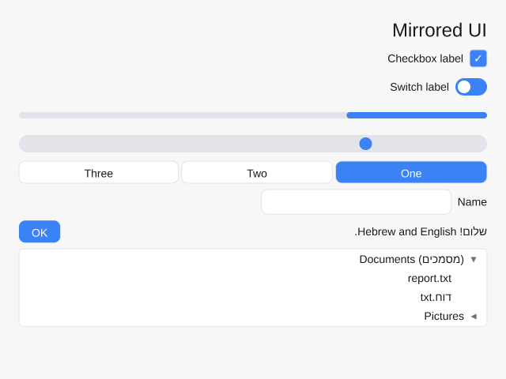

# Right-to-left and bidirectional text

Stipple draws Hebrew, Arabic and text that mixes them with left-to-right
scripts. Text is always stored in logical order, the order it's typed and read.
When it's drawn, each paragraph goes through the Unicode Bidirectional
Algorithm (UAX #9), implemented by `oxideav-scribe`, and its runs are placed in
visual order.


```rust
use stipple::render::TextDirection;
use stipple::widgets::{label, paragraph};

// Direction detected from the first strong character: right to left here.
let hello = label(&theme, "שלום, עולם");
// A paragraph forced right to left, whatever it starts with.
let note = paragraph(&theme, "2024 היה שנה טובה").direction(TextDirection::Rtl);
```

## Paragraph direction

Every paragraph (text between `\n`s) has a base direction, set by
`Element::direction`:

| `TextDirection` | Meaning |
|---|---|
| `Auto` (default) | The paragraph's first strong character decides (UAX #9 rules P2/P3): a Hebrew or Arabic letter makes it right to left, a Latin, Greek, Cyrillic or CJK one left to right. No strong character means left to right. |
| `Ltr` | Left to right. |
| `Rtl` | Right to left. |

`Element::direction` on a stack or grid sets it on every text element inside.
With `Auto`, each paragraph of a multi-line text decides on its own.

The base direction decides where the line starts, how neutral characters
(spaces, punctuation) between runs of different directions resolve, and the
alignment: right-to-left paragraphs line up against the right edge of the text
element's box. A label sized to its text looks the same either way; a stretched
label, a wrapped paragraph, or the text in a `text_editor` or `text_area` sits
on the right.

## Shaping and wrapping

Each display line is cut into runs of one embedding level. Each run is shaped
in logical order, so Arabic letters take their joining forms and ligatures form
as usual, then the runs are placed left to right in visual order (rule L2).
Brackets and other mirrored characters in right-to-left runs are drawn
mirrored (rule L4). Numbers keep their left-to-right digit order inside
right-to-left text.

Wrapping picks breaks on the logical text, at spaces, exactly as for
left-to-right text; each wrapped line is then reordered on its own, with
trailing spaces moved to the paragraph's end (rule L1).

Arabic joining comes from scribe, which substitutes the Arabic Presentation
Forms before looking glyphs up. Fonts that carry those forms (DejaVu Sans,
which `Font::system_default` adds as a fallback, Amiri) join correctly; a font
that only has the OpenType `init`/`medi`/`fina` features, such as Noto Sans
Arabic, shows isolated letters for now.

## Editing

`EditBuffer` keeps the caret and selection as logical byte indices, so typing,
Backspace and Delete always act on the text's logical order: Backspace removes
the character typed last, whatever side of the caret it's drawn on.

- **Arrow keys move visually.** Left and Right step the caret to the next
  character edge on screen, so inside right-to-left text Left moves forward
  through the text. At a line's visual end the caret crosses to the previous
  or next line. Shift+Left/Right extends the selection the same way; Left or
  Right with a selection collapses it to its visual left or right end (taken
  from the line's direction).
- **Word movement, Home and End are logical.** Ctrl/Option+Left/Right move by
  words in text order, and Home and End go to the logical start and end of the
  line (the right and left edges of a right-to-left line).
- **Where the caret is drawn.** A caret sits at the leading edge of the
  character after it: the left side of a left-to-right character, the right side
  of a right-to-left one. At the end of a line it sits at the trailing edge of
  the last character. Where runs of different directions meet, one logical
  position has two possible places on screen; this rule picks one.
- **Clicks** land on the nearer edge of the character under the pointer and
  map to the logical index on that side of it: clicking the left half of a
  Hebrew letter puts the caret after it.
- **Selection** is a logical range, so in mixed text it can show as several
  rectangles on one line.

`EditBuffer::set_direction` (or `with_direction`) sets the paragraph direction
for both editing and drawing; `text_editor` and `text_area` pass it to their
text.

## Custom drawing

`Font::layout(text, size, direction, max_width)` returns a `TextLayout`, the
same layout the widgets use. Draw it with `Scene::fill_layout`, and use
`caret_position`, `index_at` and `selection_rects` for a custom editor.
`Scene::fill_text` lays text out with `TextDirection::Auto`. In a mirrored
layout, use `Font::layout_in(.., LayoutDirection::Rtl)` to get the same
alignment the widgets get (see below).

## Mirrored layouts

An app in Arabic, Hebrew or another right-to-left language usually wants the
whole UI mirrored, not only its text: the first item of a row on the right,
checkboxes right of their labels, sliders filling from the right. Set the
theme's layout direction:

```rust
use stipple::prelude::*;

let app = App::new(state, view)
    .theme(Theme::light().with_layout_direction(LayoutDirection::Rtl));
```



The default is left to right. Stipple doesn't mirror on its own, since a UI
whose strings aren't translated shouldn't flip. To follow the locale, pick the
direction from it: `LayoutDirection::from_env()` reads `LC_ALL`, `LC_MESSAGES`
and `LANG`, and `LayoutDirection::for_language("ar-EG")` maps a language tag
(Arabic, Hebrew, Persian, Urdu, Yiddish, Pashto, Sindhi, Kurdish, Uyghur,
Dhivehi and a few more read right to left). On Windows and macOS the
environment usually doesn't carry the UI language, so pass the language your
app is showing.

`Element::layout_direction(dir)` sets the direction of one element and
everything inside it, and is inherited down the tree. Use
`LayoutDirection::Ltr` for a part of a mirrored UI that must keep its
orientation (media transport buttons, a chart, a phone number), or
`LayoutDirection::Rtl` for a mirrored panel in a left-to-right app.

### What mirrors

A right-to-left element lays its children out as it would left to right, then
reflects each child's box about its own middle. So in a right-to-left
subtree:

- Rows run right to left, wrapped rows too (each line starts on the right).
- `Align::Start` on a horizontal axis is the right edge and `Align::End` the
  left one: a row's main-axis alignment, a column's cross-axis alignment, and
  a grid cell's horizontal alignment. Vertical alignment doesn't change.
- Grid columns count from the right: column 0 is the rightmost.
- Padding's `left` inset is the start side, so it lands on the right (and
  `right` on the left). `Insets` keeps `left` and `right` names; read them as
  start and end.
- Text with `TextDirection::Auto` lines up against the right edge, whatever its
  own direction: a stretched Latin label, a text field's contents and its
  caret all start on the right. A paragraph with no strong character (an empty
  field, a number) gets a right-to-left base direction. Each paragraph's
  reading order is still detected from its characters, so "abc" still reads
  left to right. Text with an explicit `Ltr` or `Rtl` keeps its own side.
- Glyphs, images and anything drawn with a fixed orientation are never
  flipped. An image's left and right padding swap.

Widgets follow:

- `checkbox`, `radio` and `switch` sit right of a label that comes after them
  in a row; a switch's knob is on the left when on.
- `slider` and `progress_bar` fill from the right, and dragging a slider
  measures from the right edge.
- `tabs` and `toolbar`s start on the right; `split_pane`'s first pane is the
  right one.
- `tree` indents from the right and its collapsed triangles point left (◄).
- Menus Stipple draws: the menu bar starts on the right, a menu lines up with
  its title's right edge, submenus open to the left of their item (their
  arrows point left), and context menus open leftwards from the pointer.
  `select` dropdowns line up with the button's right edge, and toasts placed
  with `Align::Start` / `Align::End` swap sides. Overlays placed with
  `Anchor::At` (exact coordinates) and `Anchor::Center` stay where they are.
- Left and Right swap in a `tree` (Left expands, Right collapses), a
  `split_pane` (the divider moves the way the arrow points) and menus (Left
  goes to the next menu on the bar and into a submenu). Text editing keys
  don't change: Left and Right already move visually in text.
- Under `Theme::native`, switches, sliders and progress bars draw themselves
  in a mirrored UI, since the OS would draw them left to right. Other native
  controls are symmetric.

Drag handlers on a mirrored element get a mirrored `DragMotion`
(`DragMotion::mirrored`): x is measured from the right of the parent, so
`fraction_x` counts from the right edge and dragging left is a positive x
delta. A handler written for a left-to-right layout works unchanged. Pointer
positions given to tap and context handlers are real window positions.

Stipple has no scroll bars to move: scroll containers scroll vertically and
show no bar. Layouts built from absolute positions (`Anchor::At`, custom
drawing) aren't mirrored; compute those from the window's right edge.

`LayoutNode::rtl` says whether a laid-out node was mirrored, and
`stipple::core::layout_with_direction` lays a tree out with a root direction
(`layout` is left to right). The `bididemo --mirror` example shows a
mirrored UI; CI checks it on X11, Windows and macOS.

## Not done yet

- scribe's shaper doesn't report which characters each glyph came from, so in a
  run where glyphs and characters don't match one to one (a ligature such as
  lam-alef, or an Indic cluster) caret positions are measured from shaped
  prefixes, which can be slightly off inside the ligature.
- Up and Down in a `text_area` keep the byte column, not the visual x.
