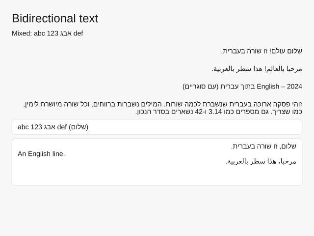

# Right-to-left and bidirectional text

Stipple draws Hebrew, Arabic and text that mixes them with left-to-right
scripts. Text is always stored in logical order, the order it's typed and read.
When it's drawn, each paragraph goes through the Unicode Bidirectional
Algorithm (UAX #9), implemented by `oxideav-scribe`, and its runs are placed in
visual order.



```rust
use stipple::render::TextDirection;
use stipple::widgets::{label, paragraph};

// Direction detected from the first strong character: right to left here.
let hello = label(&theme, "שלום, עולם");
// A paragraph forced right to left, whatever it starts with.
let note = paragraph(&theme, "2024 היה שנה טובה").direction(TextDirection::Rtl);
```

## Paragraph direction

Every paragraph (text between `\n`s) has a base direction, set by
`Element::direction`:

| `TextDirection` | Meaning |
|---|---|
| `Auto` (default) | The paragraph's first strong character decides (UAX #9 rules P2/P3): a Hebrew or Arabic letter makes it right to left, a Latin, Greek, Cyrillic or CJK one left to right. No strong character means left to right. |
| `Ltr` | Left to right. |
| `Rtl` | Right to left. |

`Element::direction` on a stack or grid sets it on every text element inside.
With `Auto`, each paragraph of a multi-line text decides on its own.

The base direction decides where the line starts, how neutral characters
(spaces, punctuation) between runs of different directions resolve, and the
alignment: right-to-left paragraphs line up against the right edge of the text
element's box. A label sized to its text looks the same either way; a stretched
label, a wrapped paragraph, or the text in a `text_editor` or `text_area` sits
on the right.

## Shaping and wrapping

Each display line is cut into runs of one embedding level. Each run is shaped
in logical order, so Arabic letters take their joining forms and ligatures form
as usual, then the runs are placed left to right in visual order (rule L2).
Brackets and other mirrored characters in right-to-left runs are drawn
mirrored (rule L4). Numbers keep their left-to-right digit order inside
right-to-left text.

Wrapping picks breaks on the logical text, at spaces, exactly as for
left-to-right text; each wrapped line is then reordered on its own, with
trailing spaces moved to the paragraph's end (rule L1).

Arabic joining comes from scribe, which substitutes the Arabic Presentation
Forms before looking glyphs up. Fonts that carry those forms (DejaVu Sans,
which `Font::system_default` adds as a fallback, Amiri) join correctly; a font
that only has the OpenType `init`/`medi`/`fina` features, such as Noto Sans
Arabic, shows isolated letters for now.

## Editing

`EditBuffer` keeps the caret and selection as logical byte indices, so typing,
Backspace and Delete always act on the text's logical order: Backspace removes
the character typed last, whatever side of the caret it's drawn on.

- **Arrow keys move visually.** Left and Right step the caret to the next
  character edge on screen, so inside right-to-left text Left moves forward
  through the text. At a line's visual end the caret crosses to the previous
  or next line. Shift+Left/Right extends the selection the same way; Left or
  Right with a selection collapses it to its visual left or right end (taken
  from the line's direction).
- **Word movement, Home and End are logical.** Ctrl/Option+Left/Right move by
  words in text order, and Home and End go to the logical start and end of the
  line (the right and left edges of a right-to-left line).
- **Where the caret is drawn.** A caret sits at the leading edge of the
  character after it: the left side of a left-to-right character, the right side
  of a right-to-left one. At the end of a line it sits at the trailing edge of
  the last character. Where runs of different directions meet, one logical
  position has two possible places on screen; this rule picks one.
- **Clicks** land on the nearer edge of the character under the pointer and
  map to the logical index on that side of it: clicking the left half of a
  Hebrew letter puts the caret after it.
- **Selection** is a logical range, so in mixed text it can show as several
  rectangles on one line.

`EditBuffer::set_direction` (or `with_direction`) sets the paragraph direction
for both editing and drawing; `text_editor` and `text_area` pass it to their
text.

## Custom drawing

`Font::layout(text, size, direction, max_width)` returns a `TextLayout`, the
same layout the widgets use. Draw it with `Scene::fill_layout`, and use
`caret_position`, `index_at` and `selection_rects` for a custom editor.
`Scene::fill_text` lays text out with `TextDirection::Auto`.

## Not done yet

- Mirroring layouts: Stipple doesn't yet flip row order or start/end alignment
  for a right-to-left UI. An app can reverse its own rows and pick
  `Align::End` for now.
- The GPU renderer (`stipple::gpu`) draws text character by character from an
  atlas and ignores bidi; the CPU renderer, which every backend uses by
  default, is bidi-aware.
- scribe's shaper doesn't report which characters each glyph came from, so in a
  run where glyphs and characters don't match one to one (a ligature such as
  lam-alef, or an Indic cluster) caret positions are measured from shaped
  prefixes, which can be slightly off inside the ligature.
- Up and Down in a `text_area` keep the byte column, not the visual x.
