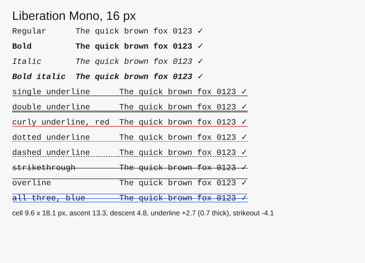

# Fonts and text decorations

Text is shaped by `oxideav-scribe` and drawn by the same CPU rasterizer as
everything else, so fonts behave the same on every platform. This page covers
choosing fonts, styling text, and the lines drawn along it.



## Fonts are handles

A `Font` is a family (its regular, bold, italic … faces) drawn in one
`FontStyle`, with the fonts it falls back to for characters it lacks. It is
cheap to clone: hand a copy to every element or glyph run that draws with it.
Two fonts compare equal when they draw the same faces in the same style, and
`Font::id()` gives a `FontId` to key caches (a glyph atlas, say) by.

## Getting a font

```rust
use stipple::prelude::*;

// An installed family, by name (case and spaces don't matter).
let mono = Font::from_family("JetBrains Mono", FontStyle::NORMAL)
    // A generic family, resolved to what this system has.
    .or_else(|_| Font::from_family("monospace", FontStyle::NORMAL))?;

// What a font picker lists: name, monospace flag, the styles it has faces for.
for family in Font::families() {
    println!("{} {:?}", family.name, family.monospace);
}

// Fonts the app ships.
let ui = Font::from_bytes(include_bytes!("Inter-Regular.ttf").to_vec())?
    .with_face(include_bytes!("Inter-Bold.ttf").to_vec())?;
```

The generic names are `sans-serif`, `serif`, `monospace`, `system-ui`,
`emoji`, `cjk` and `symbol`. `Font::system_default()` remains a quick way to
get some sans-serif face in examples and tests.

### Where system fonts come from

There is no font library underneath; Stipple reads the font directories
itself, opening each file only for its header tables (names, weight, slant,
spacing), and caches the list for the process. The first `from_family` or
`families` call pays for that scan.

| Platform | Directories |
|---|---|
| Linux, BSDs | those fontconfig's configuration lists (`/etc/fonts/fonts.conf` or `$FONTCONFIG_FILE`, following its `<include>`s), else `/usr/share/fonts`, `/usr/local/share/fonts`, `~/.local/share/fonts`, `~/.fonts` |
| Windows | `%WINDIR%\Fonts` and the per-user `%LOCALAPPDATA%\Microsoft\Windows\Fonts` |
| macOS | `/System/Library/Fonts`, `/Library/Fonts`, `/Network/Library/Fonts`, `~/Library/Fonts` |
| iOS | `/System/Library/Fonts` |
| Android | `/system/fonts`, `/product/fonts` |
| Web | none: load the app's fonts with `Font::from_bytes` |

`STIPPLE_FONT_DIRS` (a `PATH`-style list) adds directories, searched first.

On Linux, fontconfig's `<alias>` rules are honored too: `monospace` takes the
first installed family of its `prefer` list (so a user's `fonts.conf`
preference wins), and a missing family falls to its `accept` substitutes
(Liberation Sans for Arial). Each platform also has built-in candidates for the
generic names (Menlo on macOS, Consolas on Windows, DejaVu Sans Mono on Linux).
Fontconfig's `<match>` rules and binary caches are not read.

Faces with CFF (PostScript) outlines (`.otf` with an `OTTO` header) are skipped:
the shaper's face chain only handles TrueType outlines for now.

## Bold, italic and other weights

```rust
let bold = mono.bold();                         // FontWeight::BOLD
let light_italic = mono.styled(FontStyle {
    weight: FontWeight::LIGHT,
    italic: true,
});
```

`styled` picks the family's face the way CSS does: the requested slant first,
then the nearest weight (heavier first above 500, lighter first below 400).
Faces of normal width are preferred over condensed or expanded ones. When the
family has no such face, the style is synthesized: an outline thickened for
bold, a 12° slant for italic. `font.is_synthesized()` says which. Each style is
loaded once and shared by every handle that asks for it.

## Fallbacks

```rust
let cjk = Font::from_family("cjk", FontStyle::NORMAL)?;
let emoji = Font::from_family("emoji", FontStyle::NORMAL)?;
let font = mono.with_fallbacks(&[cjk, emoji]);
// Or whatever this system has for symbols, CJK and emoji:
let font = mono.with_system_fallbacks();
```

A character the font has no glyph for is drawn from the first fallback that
has one, in order. Fallbacks follow the requested style: bold text uses each
fallback's bold face, where it has one. CJK and emoji fonts are large, and each
style drawn keeps its own copy, so add them when the text needs them.

## Fonts on elements

`App::font` sets the font for the whole app. Any text element, or a container
(applying to the text inside it that doesn't set its own), can change it:

```rust
Element::text("Title", 20.0, ink).bold();
Element::text("Note", 14.0, ink).italic();
Element::text("let x = 1;", 14.0, ink).font(mono.clone());
column(rows).font(mono.clone()).weight(FontWeight::MEDIUM);
```

These set the element's `TextStyle` (`font`, `weight`, `italic`,
`decoration`), which `TextStyle::resolve` turns into the font drawn with.

## Metrics

`font.metrics(size_px)` returns a `FontMetrics`: ascent, descent, line gap and
line height, cap and x height, the widest advance, the underline's and the
strikeout's position and thickness, and whether the font is monospaced.
`font.advance_of(c, size_px)` is one character's advance: for a monospaced
font, a terminal cell's width.

Positions are offsets from the baseline growing downward, and each is the top
edge of its stroke. The line metrics are the ones the font recommends for line
spacing (its `hhea` values, or its typographic ones when it asks for those), as
FreeType and Core Text report them. Stipple's own text layout
(`Font::line_height`, `Font::baseline`) uses the font's typographic box, which
can be tighter.

## Decorations

```rust
Element::text("misspeled", 14.0, ink)
    .decorate(Decoration::underline(UnderlineStyle::Curly).with_color(red));
Element::text("old price", 14.0, ink).strikethrough();
Element::text("heading", 14.0, ink).decorate(Decoration::overline().with_underline(UnderlineStyle::Double));
```

`Decoration` holds an optional underline (`Single`, `Double`, `Curly`,
`Dotted`, `Dashed`), a strikethrough, an overline, and a color (the text's when
`None`) — a terminal's SGR 4:x, 9, 53 and 58. Positions and thickness come
from the font's metrics; straight lines are snapped to whole pixels.

To draw text yourself, `Scene::fill_layout` draws a `TextLayout` and
`Scene::decorate_layout` its decorations; `Scene::draw_decoration` draws one
run's lines given its metrics, baseline start and width.

`Element::underline(range)` is something else: it underlines a byte range, for
menu mnemonics.

## Trying it

`cargo run -p fontdemo` shows the `monospace` family in four styles and every
decoration; `--family "Name"` picks another family, `--list` prints the
installed families, and `--check` renders off screen and checks the result (CI
runs it on X11, Windows and macOS, and screenshots the window on X11).

## Limits

- Shaping consults the fallbacks per character, and the shaper re-parses a
  face's tables for each lookup (oxideav-scribe issue #17), so long fallback
  chains make shaping new strings slower; shaped runs are cached per font and
  style.
- Variable fonts draw their default instance; weights come from separate
  faces or synthesis.
- Synthetic bold doesn't widen advances, so it keeps a monospaced grid.
