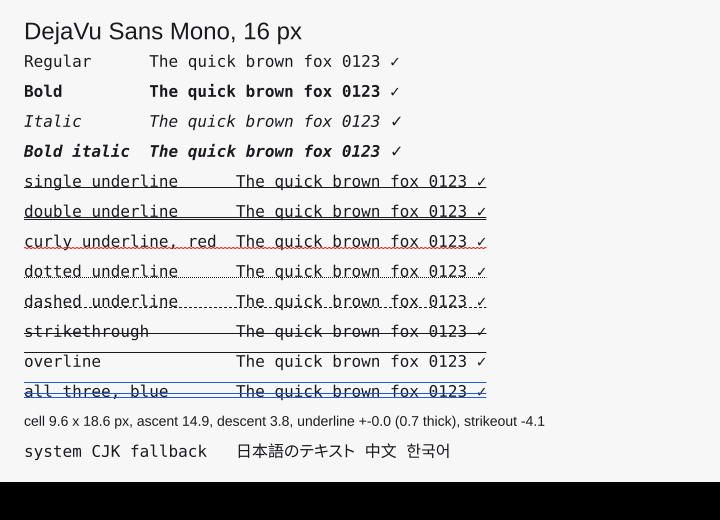

# Fonts and text decorations

Text is shaped by `oxideav-scribe` and drawn by the same CPU rasterizer as
everything else, so fonts behave the same on every platform. This page covers
choosing fonts, styling text, and the lines drawn along it.



## Fonts are handles

A `Font` is a family (its regular, bold, italic … faces) drawn in one
`FontStyle`, with the fonts it falls back to for characters it lacks. It is
cheap to clone: hand a copy to every element or glyph run that draws with it.
Two fonts compare equal when they draw the same faces in the same style, and
`Font::id()` gives a `FontId` to key caches (a glyph atlas, say) by.

## Getting a font

```rust
use stipple::prelude::*;

// An installed family, by name (case and spaces don't matter).
let mono = Font::from_family("JetBrains Mono", FontStyle::NORMAL)
    // A generic family, resolved to what this system has.
    .or_else(|_| Font::from_family("monospace", FontStyle::NORMAL))?;

// What a font picker lists: name, monospace flag, the styles it has faces for.
for family in Font::families() {
    println!("{} {:?}", family.name, family.monospace);
}

// Fonts the app ships (TrueType or OpenType, .ttf, .otf, .ttc).
let ui = Font::from_bytes(include_bytes!("Inter-Regular.ttf").to_vec())?
    .with_face(include_bytes!("Inter-Bold.ttf").to_vec())?;
```

The generic names are `sans-serif`, `serif`, `monospace`, `system-ui`,
`emoji`, `cjk` and `symbol`. `Font::system_default()` is the sans-serif face
an app draws with when it sets none (it says so on stderr, once, if the
system has none of the faces it looks for); it falls back to the system's
CJK, emoji and symbol fonts (see [Fallbacks](#fallbacks)).

Outlines can be TrueType (`glyf`) or PostScript (`CFF `, and the variable
`CFF2`, drawn at its default instance), in a single font (`.ttf`, `.otf`) or
a collection (`.ttc`, `.otc`): the CJK fonts Android, macOS and most Linux
distributions ship (Noto Sans CJK, Hiragino, Source Han Sans) are CFF
collections. `oxideav-ttf` reads both kinds into the same outlines, so
shaping, fallback, metrics and drawing (CPU and GPU) treat them alike. CFF
curves are flattened to short lines in font units, which is invisible at
text sizes.

### Where system fonts come from

There is no font library underneath; Stipple reads the font directories
itself, opening each file only for its header tables (names, weight, slant,
spacing), and caches the list for the process. The first `from_family` or
`families` call pays for that scan.

The system fallbacks (the `cjk`, `emoji` and `symbol` families a font
falls back to for characters it lacks) are found through the same list,
when text first needs them. Once a text field gets the input method, the
App's thread stops loading them itself: when its text first needs one, the
list is built and the fallback resolved and read on a background thread,
the text is drawn without it for that moment (boxes for the missing
glyphs), and the windows are drawn again when it's ready (nothing is read
ahead: indexing as the field got focus slowed the input method's own
start). Indexing can take
seconds on a cold disk (2 to 8 s for 147 files on CI's Windows runners,
where the antivirus scans each file as it's opened), and the first such
text is usually an input method's first preedit, which a stalled UI thread
breaks: the Microsoft Japanese IME lost the keys typed meanwhile, or left
its composition stuck. Before any text input (Japanese labels, a headless
render) fallbacks still load when the text needs them, on its thread
(`src/render/font/warm.rs`).

| Platform | Directories |
|---|---|
| Linux, BSDs | those fontconfig's configuration lists (`/etc/fonts/fonts.conf` or `$FONTCONFIG_FILE`, following its `<include>`s), else `/usr/share/fonts`, `/usr/local/share/fonts`, `~/.local/share/fonts`, `~/.fonts` |
| Windows | `%WINDIR%\Fonts` and the per-user `%LOCALAPPDATA%\Microsoft\Windows\Fonts` |
| macOS | `/System/Library/Fonts`, `/Library/Fonts`, `/Network/Library/Fonts`, `~/Library/Fonts` |
| iOS | `/System/Library/Fonts` |
| Android | `/system/fonts`, `/product/fonts` |
| Web | none: load the app's fonts with `Font::from_bytes` |

`STIPPLE_FONT_DIRS` (a `PATH`-style list) adds directories, searched first.

On Linux, fontconfig's `<alias>` rules are honored too: `monospace` takes the
first installed family of its `prefer` list (so a user's `fonts.conf`
preference wins), and a missing family falls to its `accept` substitutes
(Liberation Sans for Arial). Each platform also has built-in candidates for the
generic names (Menlo on macOS, Consolas on Windows, DejaVu Sans Mono on Linux).
Fontconfig's `<match>` rules and binary caches are not read.

The `cjk` family is, in order of preference:

| Platform | `cjk` |
|---|---|
| Android | Noto Sans CJK (`/system/fonts/NotoSansCJK-Regular.ttc`) |
| Linux, BSDs | Noto Sans CJK (`fonts-noto-cjk`, in `/usr/share/fonts/opentype/noto`), Source Han Sans, Droid Sans Fallback, WenQuanYi, VL Gothic, IPA Gothic, Nanum Gothic … |
| macOS, iOS | Hiragino Sans, PingFang SC, Apple SD Gothic Neo |
| Windows | Microsoft YaHei, Yu Gothic, Malgun Gothic, MS Gothic, SimSun |
| Web | none: pass a CJK font in `stipple.js`'s `font` list (see [web](platforms/web.md)) |

On Linux and Android, Noto Sans CJK has a face per region (Han characters are
drawn differently in Japan, Korea, China, Taiwan and Hong Kong); on Linux the
one for the locale's region (`LC_ALL`, `LC_CTYPE` or `LANG`, say `ja_JP`) comes
first. Where the `cjk` family has no Hangul (Hiragino, Yu Gothic), the system fallbacks add a
Korean family after it (Apple SD Gothic Neo, Malgun Gothic, Noto Sans CJK KR,
Nanum Gothic).

## Bold, italic and other weights

```rust
let bold = mono.bold();                         // FontWeight::BOLD
let light_italic = mono.styled(FontStyle::ITALIC.weight(FontWeight::LIGHT));
```

`styled` picks the family's face the way CSS does: the requested slant first,
then the nearest weight (heavier first above 500, lighter first below 400).
Faces of normal width are preferred over condensed or expanded ones. When the
family has no such face, the style is synthesized: an outline thickened for
bold, a 12° slant for italic. `font.is_synthesized()` says which. Each style is
loaded once and shared by every handle that asks for it.

## Fallbacks

```rust
let cjk = Font::from_family("cjk", FontStyle::NORMAL)?;
let emoji = Font::from_family("emoji", FontStyle::NORMAL)?;
let font = mono.with_fallbacks(&[cjk, emoji]);
// Or whatever this system has for symbols, CJK and emoji:
let font = mono.with_system_fallbacks();
```

A character the font has no glyph for is drawn from the first fallback that
has one, in order. Fallbacks follow the requested style: bold text uses each
fallback's bold face, where it has one. CJK and emoji fonts are large (5 to
20 MB), and each style drawn keeps its own copy.

The system's fallbacks (`with_system_fallbacks()`, which
`Font::system_default()` already has) are loaded only when text needs them: the
first time a string has a character no face of the font has, the system family
for it joins the chain (`cjk` for Han, kana and Hangul, then a Korean family
if that one lacks Hangul; `emoji` for pictographs; `symbol` for the rest),
once per style. An app that never shows Japanese never loads a CJK font, and a
translated one draws Japanese, Chinese and Korean without asking for it.

## Fonts on elements

`App::font` sets the font for the whole app (by default, `Font::system_default()`,
loaded when the first frame is laid out; `App::no_font` draws no text at all,
for pixel tests that mustn't depend on installed fonts). Any text element, or a container
(applying to the text inside it that doesn't set its own), can change it:

```rust
Element::text("Title", 20.0, ink).bold();
Element::text("Note", 14.0, ink).italic();
Element::text("let x = 1;", 14.0, ink).font(mono.clone());
column(rows).font(mono.clone()).weight(FontWeight::MEDIUM);
```

These set the element's text style (its font, weight, slant and decoration
lines), which resolves against the app's font into the font drawn with.

## Metrics

`font.metrics(size_px)` returns a `FontMetrics`: ascent, descent, line gap and
line height, cap and x height, the widest advance, the underline's and the
strikeout's position and thickness, and whether the font is monospaced.
`font.advance_of(c, size_px)` is one character's advance: for a monospaced
font, a terminal cell's width.

Positions are offsets from the baseline growing downward, and each is the top
edge of its stroke. The line metrics are the ones the font recommends for line
spacing (its `hhea` values, or its typographic ones when it asks for those), as
FreeType and Core Text report them. Stipple's own text layout
(`Font::line_height`, `Font::baseline`) uses the font's typographic box, which
can be tighter.

## Decorations

```rust
Element::text("misspeled", 14.0, ink)
    .decorate(Decoration::NONE.underline(UnderlineStyle::Curly).color(red));
Element::text("old price", 14.0, ink).strikethrough();
Element::text("heading", 14.0, ink).decorate(Decoration::NONE.overline().underline(UnderlineStyle::Double));
```

`Decoration` holds an optional underline (`Single`, `Double`, `Curly`,
`Dotted`, `Dashed`), a strikethrough, an overline, and a color (the text's when
`None`) — a terminal's SGR 4:x, 9, 53 and 58. Positions and thickness come
from the font's metrics; straight lines are snapped to whole pixels.

To draw text yourself, `Scene::fill_text(text, origin, &paint)` draws a string
in a `TextPaint` (font, size, color and an optional decoration:
`TextPaint::new(&font, 14.0, color).decoration(deco)`); `Scene::fill_layout`
draws a `TextLayout` and `Scene::decorate_layout` its decorations; and
`Scene::draw_decoration(baseline, width, &paint)` draws one run's lines given
its baseline start and width.

`Element::underline(range)` is something else: it underlines a byte range, for
menu mnemonics.

## Rich text

`RichText` is one text made of runs, each with its own `SpanStyle`, and
images in the line. It wraps across runs, and right-to-left and mixed text
is reordered as one text, so a line of game UI doesn't have to be a `row` of
labels:

<!-- live: richtext -->

```rust
let coin = Arc::new(Svg::parse(COIN_SVG)?);
let line = RichText::new()
    .push("Sold 3 × ")
    .styled("Healing Potion", SpanStyle::new().color(purple).bold())
    .push(" for 120 ")
    .icon(InlineIcon::new(coin).alt(" gold"))
    .push(".");
label(cx, line);
paragraph(cx, RichText::new().push("You ").italic("really").push(" think so?"));
```

- `SpanStyle` sets a run's `color`, `font`, `weight` (`bold()`), `italic()`,
  `size`, decoration (`decorate`, `underline`, `strikethrough`) and
  `background` (a color filled behind the run, as tall as its line); whatever
  it leaves unset is the element's (or the `TextPaint`'s). `RichText::bold`,
  `italic` and `colored` are shorthands.
- A line is as tall as its tallest run or image, and every run of a line
  sits on one baseline.
- `InlineIcon` takes a bitmap or an SVG, as tall as the text unless given a
  `height`, as wide as its aspect ratio makes it, centered on the middle of the
  capitals. In the text it is one U+FFFC character (what `RichText::text`
  returns and selection indices count); `alt` stands for it when the text is
  copied or read by a screen reader (`RichText::plain_text`).
- Shaping happens per run, so a ligature or Arabic joining doesn't cross a
  change of style.
- Cut to its box or to a number of lines with an ellipsis, rich text keeps
  its runs: `.ellipsis(Ellipsis::End)` and `.max_lines(n)` on the element
  (see [widgets.md](widgets.md)).
- `label`, `heading` and `paragraph` take a `RichText` or a string;
  `Element::rich_text(text, size, color)` is the bare element.
- To draw it yourself: `Scene::fill_rich_text(&text, origin, &paint)`, or
  `text.layout(&font, size, direction, max_width)` and `Scene::fill_layout`.
- A `FloatImage` (`RichText::float`) floats left or right, or sits anywhere,
  and the text flows around it, keeping out of its box or of its opaque
  pixels only: see [text-flow.md](text-flow.md).

## Outline and shadow

Text over artwork needs a stroke or a shadow to stay readable:

```rust
Element::text("Victory!", 40.0, Color::WHITE)
    .text_outline(TextOutline::new(2.5, Color::BLACK))
    .text_shadow(TextShadow::new(Vec2::new(2.0, 3.0), Color::rgba(0, 0, 0, 150)).blur(2.0));
let paint = TextPaint::new(&font, 18.0, Color::WHITE).outline(TextOutline::new(1.5, Color::BLACK));
```

- The outline reaches `width` beyond the glyphs' edges, drawn behind them so
  the letters keep their shape. A translucent color is composited once over
  the whole line, so overlapping strokes don't darken.
- The shadow is the glyphs (and their outline) again, `offset` away, under
  everything. `blur` softens it: three stroked layers, each wider and fainter,
  rather than a true Gaussian blur, which is cheap and close at the few
  pixels text shadows use. Images in rich text cast no shadow.
- On a container, both apply to the text inside that has none of its own.
- Both come from the glyphs' outlines, so they draw the same on the CPU and
  the GPU, where each is cached per glyph, size, color and width like the
  glyphs themselves. `Scene::outline_layout` and `Scene::shadow_layout` draw
  them for a `TextLayout` of your own (call them before `fill_layout`).

## Trying it

`cargo run --example fontdemo` shows the `monospace` family in four styles and every
decoration; `--family "Name"` picks another family, `--list` prints the
installed families, and `--check` renders off screen and checks the result (CI
runs it on X11, Windows and macOS, and screenshots the window on X11).

## Ligatures and color glyphs

Text is shaped with the OpenType features other toolkits turn on by default:
`ccmp`, `liga`, `clig`, `rlig`, `calt`, kerning and mark positioning, and the
substitutions complex scripts need. Discretionary (`dlig`), historical
(`hlig`) and stylistic forms stay off, so Roboto doesn't join every "st".

Emoji and other color glyphs draw in their own colors in every format the
system fonts use: `sbix` bitmaps (Apple Color Emoji), `CBDT` bitmaps (Noto
Color Emoji), and `COLR`/`CPAL` layers (Segoe UI Emoji, Twemoji), both version
0's flat layers and version 1's paint graphs (gradients, transforms). A
bitmap is resampled to the pixels it covers at the window's scale; a layered
glyph stays vector. Layers in the text's color take the color it is drawn
in. Both are cached, so a screen of emoji isn't rebuilt every frame.

### Emoji sequences

Many emoji are several characters drawn as one glyph: a skin tone after a
hand (👍🏽), two regional indicators making a flag (🇯🇵), a keycap (1️⃣), people
and objects joined by zero-width joiners (👩🏽‍💻, 🏳️‍🌈), tag characters
(England's flag), a selector asking for the emoji form (❤️). Shaping finds
these sequences in the text and gives each whole sequence to the first
color font in the chain that has its first character, rather than each
character to the first font that has it (the joiner from the text font, a
digit from the text font, the selector from a symbol font), so the emoji
font's ligature can form:

- Noto Color Emoji and Segoe UI Emoji list their sequences in `GSUB`
  (ligatures, and for Segoe UI Emoji's couples, chained substitutions into
  layers drawn over each other); the sequence is matched with and without
  its selectors, as fonts list them either way. Ligature lookups apply one
  after the other over the whole run, as OpenType specifies, so a later one
  sees an earlier one's ligatures.
- Apple Color Emoji lists them in `morx`, Apple's own (AAT) substitution
  table, read by hand in `src/render/morx.rs`: rearrangement, contextual,
  ligature and noncontextual subtables, the chains' default features, for
  horizontal text. It is read for fonts that have no `GSUB`.

Joiners and selectors left over when the font has no glyph for a sequence
are dropped, so an unknown ZWJ sequence shows as its emoji side by side.
A lone emoji drawn as an emoji by default (😀, not ☺ without its selector)
is also drawn from the color font, even when the text font has a
monochrome one. Text with a sequence loads the system's `emoji` family if
the chain doesn't have it yet, even when the text font covers every
character (the digit and the keycap mark of 1️⃣).

`fontdemo --emoji` draws each kind of sequence through the system's fonts
and checks it is one emoji wide and in color; CI runs it on Linux (Noto
Color Emoji), Windows (Segoe UI Emoji, which has no country flags: they stay
letters there) and macOS (Apple Color Emoji).

## Limits

- Shaping consults the fallbacks per character, and the shaper re-parses a
  face's tables for each lookup (oxideav-scribe issue #17), so long fallback
  chains make shaping new strings slower; shaped runs are cached per font and
  style.
- `morx` insertion subtables aren't applied, nor features other than a
  chain's defaults; `kerx` (AAT kerning) isn't read. Which characters are
  emoji is approximated with ranges, not Unicode's full property tables.
  In a `COLR` version 1 glyph, sweep gradients draw as one color and
  composite modes other than source-over approximately.
- OpenType features can't be chosen per text yet (`tnum`, `liga` off for
  code).
- Variable fonts draw their default instance; weights come from separate
  faces or synthesis.
- Synthetic bold doesn't widen advances, so it keeps a monospaced grid.
