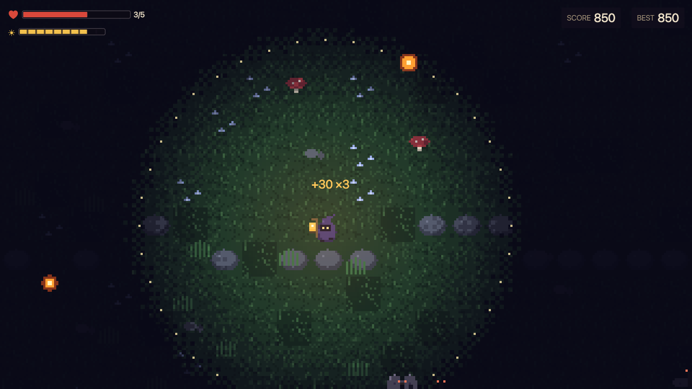
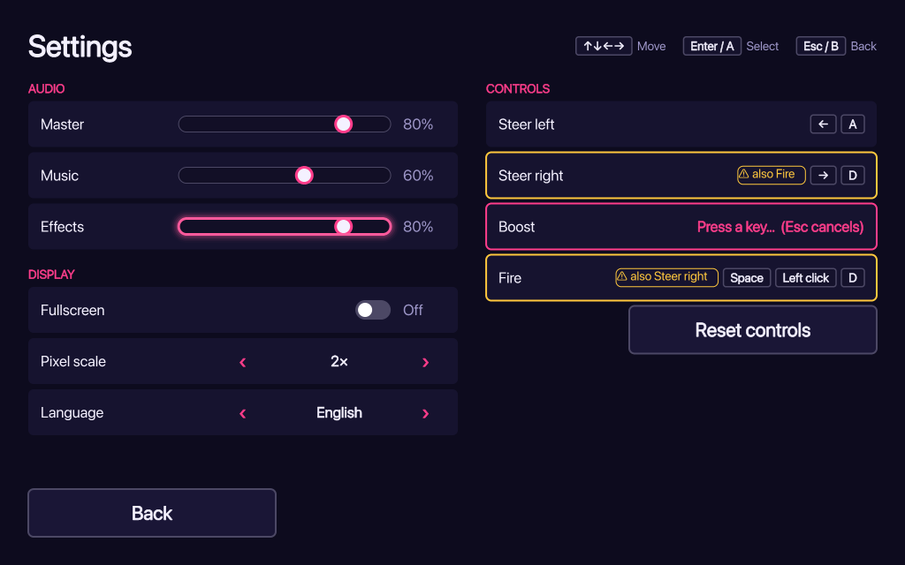

# Games

A 2D game on Stipple draws its world into a [canvas](canvas.md) once per
display frame, reads the keyboard, mouse and gamepads, and builds its menus,
HUD and settings from Stipple's widgets. `stipple::game` holds the pieces
that are a game's own:

- **The loop** ([below](#the-loop)): an update per display frame that
  repaints the canvas without rebuilding the view, pausing on its own when
  the game can't be seen.
- **A fixed time step** ([below](#a-fixed-time-step)), so the simulation
  doesn't depend on the refresh rate.
- **Input** ([below](#input)): what is held, and what was pressed and
  released since the last update.
- **Actions** ([below](#actions)): "jump", "move left", bound to inputs the
  player can change and save.
- **Drawing** ([below](#drawing)): sprite sheets and animations, tilemaps, a
  camera, and pixel art scaled by whole numbers, on fast blit paths.
- **Game UI** ([below](#game-ui)): a game theme, menus driven by the
  keyboard and gamepads, settings rows (volume, rebinding, display), a HUD
  and dialogue boxes.
- **Saving** ([below](#saving)): settings and save slots, written
  atomically with a backup.

Pointer lock is in [pointer-events.md](pointer-events.md#pointer-lock),
gamepads in [gamepads.md](gamepads.md) and sound in [audio.md](audio.md). See
the [roadmap](../ROADMAP.md#phase-9--2d-games) for what Phase 9 still lacks.

The `gameloop` example puts the pieces together in about a hundred lines: a
square moved with the arrows or WASD, stepped at 120 Hz, with an fps label.

**A whole game.** `examples/gamedemo` is "Lampwick", a small original game
built on all of it: Wick keeps a lantern in a night garden, catching the
embers that drift down (they feed the light, which burns down on its own)
while moths drawn to the light fly at it; a flare spends light to burst
them. It has a title menu, a settings screen (volume per group, rebinding
for the keyboard and the pad, fullscreen, pixel scale) saved as it changes,
a HUD (hearts, the light, a score that pops, floating "+30 ×3"), a pause
menu (Escape, Start, B or the touch "II"), a game-over screen keeping the
best score, synthesized effects and a generated music loop, pixel art at
320×180 with the camera shaking on a hit, and the keyboard, the mouse, a
gamepad and the touch controls through the same `Actions`. No image or
sound files: the sprite sheet is painted at startup. It runs on the web
too (`game.html` on the [Pages site](https://karpeleslab.github.io/stipple/game.html),
saving to `localStorage`). `gamedemo --selftest` plays a seeded game with
scripted keys at a fixed 60 Hz, off screen, checks the exact score, and
that the settings, controls and best score were saved and read back (CI
runs it); `gamedemo --shots DIR` renders its screens.

<!-- live: gamedemo -->



## The loop

<!-- live: gameloop -->

`App::on_frame(update)` runs `update(&mut state, &mut Frame)` once per
display frame, on the UI thread, while the game runs. `App::game_loop` takes
a `GameLoop` for more control:

```rust
use stipple::prelude::*;
use stipple::game::{Frame, GameLoop};
use std::cell::RefCell;
use std::rc::Rc;

const WORLD: CanvasId = CanvasId(1);

#[derive(Default)]
struct World { x: f64 }

struct Game { world: Rc<RefCell<World>>, score: u32, paused: bool }

fn update(g: &mut Game, frame: &mut Frame) {
    g.world.borrow_mut().x += 60.0 * frame.dt_secs();
    frame.repaint(WORLD); // the canvas changed, the view didn't
    if frame.input().key_pressed(PhysicalKey::SPACE) {
        g.score += 1;
        frame.rebuild(); // the HUD shows the score
    }
}

fn view(g: &Game, cx: &mut Cx<Game>) -> Element {
    let world = g.world.clone();
    column(vec![
        label(cx, format!("Score: {}", g.score)),
        Element::canvas(WORLD, move |c: &mut Canvas| {
            let x = world.borrow().x % c.size().width;
            c.fill_rect(Rect::from_xywh(x, 10.0, 20.0, 20.0), Color::rgb(200, 40, 40));
        })
        .grow(1.0),
    ])
}

let game = Game { world: Default::default(), score: 0, paused: false };
let app = App::new(game, view)
    .game_loop(GameLoop::new(update).paused_when(|g: &Game| g.paused));
```

**Not rebuilding the view.** An update doesn't rebuild the view on its own:
it says what changed. `frame.repaint(id)` (or `repaint_rect(id, rect)`)
paints a canvas again, and only that area is rasterized and presented, as
with [`invalidate_canvas`](canvas.md#repainting); `frame.rebuild()` rebuilds
the view after the update, for when something the view shows changed (a
score, a pause menu). A frame that only repaints the canvas doesn't build or
lay out anything; the game's tests check it, and `STIPPLE_APP_DEBUG=1
gameloop --selftest` shows it (`present: repainted` each frame, `present:
built` only when the fps label changes). Since the canvas's paint callback
doesn't get the state, keep what it draws in an `Rc<RefCell<…>>` (or
`Rc<Cell<…>>`) shared by the state and the callback.

**The `Frame`.**

- `time()`: the frame time, on the same timeline as `Cx::frame_time` and
  animations.
- `dt()` / `dt_secs()`: the time since the last frame, at most
  `GameLoop::max_dt` (100 ms unless set), so after a hitch the game slows
  down instead of jumping. `raw_dt()` is the time before that cap. The first
  frame after starting or resuming gets one refresh interval.
- `index()`: how many frames ran before.
- `input()`: the [input state](#input).
- `stats()`: a `LoopStats` with `fps`, the mean `frame_time`, `update_time`
  (the update itself) and `render_time` (presenting a frame: building the
  view when it is rebuilt, painting, rasterizing, handing it over), averaged
  over half a second, and `frames` so far.

**Pausing.** The loop runs while the game can be seen and isn't paused. It
stops, and asks for no frames at all (no CPU), while:

- `paused_when(|s| …)` returns `true`: a pause flag in the state. It is
  asked after every event and update, so a key handler, a button in a pause
  menu or the update itself pauses and resumes the game. The update doesn't
  run while paused, so resume from the view (a button, an `on_raw_key`
  handler) or an `AppHandle::update`.
- every window of the app is minimized, or the app is in the background
  (mobile, see [window-lifecycle.md](window-lifecycle.md#going-to-the-background-mobile)).
- no window has keyboard focus, with `pause_when_unfocused(true)`.

On resuming, the first frame's `dt` is one refresh interval, not the time
spent paused, and keys and buttons pressed while paused (the one that
resumed) aren't reported as presses.

**How it runs.** The loop asks the [frame clock](animation.md) for a frame
after each update, the way an animating view does, and runs the update when
the frame arrives, before the window presents. Wakes that aren't frames
(an `AppHandle::update`, a timer) don't run it. With several windows it runs
once per frame, and each window repaints the canvases asked for.

To run an update in a test, without an app, make a `Frame` yourself:
`Frame::new(time, dt, &input)`, then look at `frame.repaints()` and
`frame.rebuilds()`.

## A fixed time step

Physics stepped by the frame's `dt` changes with the refresh rate. A
`FixedStep` spends each frame's `dt` in whole steps of a fixed size and
keeps the rest for the next frame:

```rust
use stipple::game::FixedStep;
# use std::time::Duration;
# struct Body { prev: f64, pos: f64, vel: f64 }
# let mut body = Body { prev: 0.0, pos: 0.0, vel: 100.0 };
# let dt = Duration::from_millis(16);
let mut step = FixedStep::hz(120); // or FixedStep::new(Duration)
for _ in 0..step.advance(dt) {
    body.prev = body.pos;
    body.pos += body.vel * step.dt_secs();
}
// Draw between the last two states.
let drawn = body.prev + (body.pos - body.prev) * step.alpha();
```

`alpha()` is how far the leftover time is into the next step (0 to 1).
`advance` runs at most `max_steps` steps per frame (8 unless set) and drops
the time beyond, rather than falling further behind each frame;
`dropped()` says how much. `reset()` forgets the leftover time (a new
level).

## Input

`frame.input()` is an `InputState`, kept up to date from the window's events
whatever has focus:

| | |
|---|---|
| `key_held(k)`, `key_pressed(k)`, `key_released(k)` | Keys by position (`PhysicalKey`: `KEY_W`, `ARROW_LEFT`, `SPACE`, … or `PhysicalKey::from_name("KeyW")`), the same on every layout. |
| `logical_held(c)`, `logical_pressed(c)`, `logical_released(c)` | Keys by what they gave under the layout when pressed (`KeyCode::Char('w')`, letters compared without case), for "press Q to quit" where the label matters more than the position. |
| `keys_held()`, `keys_pressed()`, `modifiers()` | All of them. |
| `button_held(b)`, `button_pressed(b)`, `button_released(b)` | Mouse buttons. |
| `pointer()` | Where the pointer is in the window, `None` outside it. |
| `motion()`, `wheel()` | How far it moved (or, locked, how far the mouse moved), and the wheel turned (in pixels; lines count 40 px), since the last update. |
| `gamepad_held(pad, b)`, `gamepad_pressed(pad, b)`, `gamepad_released(pad, b)` | Gamepad buttons, on `Some(id)` or on any pad with `None` (the touch controls included). |
| `gamepad_axis(pad, axis)` | A stick (−1…1, +Y down) or trigger (0…1), no dead zone; with `None`, the pad pushing it furthest. |
| `gamepads()`, `gamepad_buttons_pressed()` | The connected pads, and the buttons pressed on them. |
| `touches()`, `touches_started()`, `touches_ended()` | The fingers down (`id`, `start`, `position`), and those that landed and lifted since the last update. |
| `last_device()` | `Keyboard`, `Mouse`, `Gamepad` or `Touch`: what to show prompts for. |

*Pressed* and *released* are edges since the last update, and they are
latched: a key (or pad button) pressed and released between two frames
reads as both on the next frame, so a quick tap is never lost. A key repeat
is not a press. When the window loses focus, every held key, button and
finger is let go and reported released, and the pads' buttons and axes
too, so nothing released in another window stays held. A pad that
disconnects reports its held buttons released. The game loop starts gamepad
support, so pads that are already connected show up on their own.

The pointer events a touch screen's first finger also produces aren't taken
as the mouse: a tap is in `touches_started()`, not `button_pressed(Left)`.

The game sees keys whether or not a widget uses them too; while a text
field in a menu has focus, pause the game (or ignore its input).

**Mouse look.** Lock the pointer (`AppHandle::set_pointer_lock(true)`, from
a click; see [pointer lock](pointer-events.md#pointer-lock)) and read
`motion()`: while locked it adds up the mouse's relative motion
(`Event::PointerDelta`) since the last update, and the pointer's moves (it is
held in place) don't count; unlocked it is how far the pointer moved. Either
way it's in logical pixels, so one sensitivity works for both:

```rust
# let input = stipple::game::InputState::new();
# let (mut yaw, mut pitch) = (0.0f64, 0.0f64);
if input.pointer_locked() {
    let m = input.motion(); // frame.input()
    yaw += m.dx * 0.15;
    pitch = (pitch - m.dy * 0.15).clamp(-89.0, 89.0);
}
```

An `InputState` can also be fed by hand (`key`, `button`, `pointer_moved`,
`add_motion`, `wheel_by`, `gamepad`, `touch`, `event`, then `end_update`
once per update), for a test or for input the game routes itself.

**Touch controls.** For phones, `TouchControls` puts a virtual stick and
buttons over the game, and they act as one more pad: a `TouchStick` moves a
pad stick, a `TouchButton` holds a pad button, so the gamepad bindings below
play them too.

```rust
use stipple::core::CanvasId;
use stipple::game::{Corner, GameLoop, ShowTouch, TouchButton, TouchControls, TouchOverlay, TouchStick};
use stipple::gamepad::GamepadButton;
use stipple::prelude::*;

let controls = TouchControls::new()
    .stick(TouchStick::left()) // the left pad stick, floating over the left half
    .button(TouchButton::new(GamepadButton::South, "A")) // bottom right
    .button(TouchButton::new(GamepadButton::East, "B").at(Corner::BottomRight, Vec2::new(160.0, 60.0)))
    .show(ShowTouch::Auto);
// The loop: GameLoop::new(update).touch_controls(controls)
// The state keeps a TouchOverlay::new(CanvasId(2)).font(Font::system_default());
// the update calls overlay.sync(frame) (it repaints when they change), and
// the view puts overlay.element(&theme) last in an Element::layers covering
// the window.
```

- A finger belongs to the control it lands on until it lifts: a button (or
  just outside it), else a free stick whose area it's in, so the left thumb
  steers while the right one holds a button. A floating stick
  (`TouchStick::left()`'s default) centers where the finger lands anywhere
  on its half of the window; `floating(false)` needs the finger on it.
  Other fingers stay the game's (`touches()`).
- The stick reads its finger's distance from the center over `radius`,
  clamped to 1, with a radial `dead_zone`; a trigger button also pulls its
  axis all the way.
- Placement: each control's center is `inset` in from a `Corner` of the
  window; `radius` sizes it.
- `ShowTouch::Auto` (the default) shows them while touch is the last device
  used: they hide on a key, a click or a pad and come back on the next touch
  (before any input, they show on iOS and Android). `Always`, or `Never`
  (off: they take no touches).
- They're drawn in the theme's colors: the stick's ring in `surface` and
  `border`, the knob and the buttons in `primary` (`primary_active` while
  held), the labels in `on_primary` (with the overlay's font).
- `input.touch_controls()` gives their state (`visible()`, `stick_value(i)`,
  `button_held(i)`) to a game that draws them itself (`paint(canvas, theme,
  font)`).

## Actions

`Actions<A>` binds the game's actions (an `enum` of yours) to inputs, and
answers per update:

```rust
use stipple::game::{Actions, Binding};
use stipple::prelude::*;

#[derive(Clone, Copy, PartialEq, Eq, Hash, Debug)]
enum Act { Left, Right, Up, Down, Jump, Steer }

let mut actions = Actions::new()
    .with(Act::Left, Binding::Key(PhysicalKey::ARROW_LEFT))
    .with(Act::Left, Binding::Key(PhysicalKey::KEY_A))
    .with(Act::Right, Binding::Key(PhysicalKey::ARROW_RIGHT))
    .with(Act::Jump, Binding::Key(PhysicalKey::SPACE))
    .with(Act::Jump, Binding::MouseButton(PointerButton::Left))
    .with(Act::Steer, Binding::KeyAxis { neg: PhysicalKey::KEY_Q, pos: PhysicalKey::KEY_E });

// In the update:
# let input = stipple::game::InputState::new();
actions.update(&input); // frame.input()
if actions.pressed(Act::Jump) { /* … */ }
let steer = actions.value(Act::Steer); // -1 to 1
let (dx, dy) = actions.axis2((Act::Left, Act::Right), (Act::Up, Act::Down));
```

- `held(a)` while any of its bindings is held; `pressed(a)` on the update it
  starts, `released(a)` on the one it stops (both on one update for a tap).
- `value(a)` adds up its bindings' values (1 for a held key or button,
  -1/0/1 for a `KeyAxis`, analog for a gamepad axis), clamped to -1…1.
  `axis2` makes a direction from four actions, `y` down, no longer than 1,
  so diagonals aren't faster.
- `Binding` is `#[non_exhaustive]`, so match it with a `_` arm.

**Gamepads.** Gamepad bindings read any pad (the touch controls included):

| binding | text | value |
|---|---|---|
| `GamepadButton(b)` | `Pad:South` | 1 while held |
| `GamepadAxis { axis, direction: Both, dead_zone }` | `PadAxis:LeftX` | the axis (−1…1, a trigger 0…1) past the dead zone, rescaled to reach 1 |
| `GamepadAxis { axis, direction: Positive, .. }` | `PadAxis:LeftX+` | the positive half as 0…1: right, down, a trigger |
| `GamepadAxis { axis, direction: Negative, .. }` | `PadAxis:LeftX-` | the negative half as 0…1: left, up |

An axis binding is held while past its dead zone, and pressed or released
when it crosses it, so a half axis is a button: `PadAxis:LeftX+@0.5` is
"pushed right more than half way" (menu navigation, a D-pad stand-in).
`Binding::axis(axis, direction)` takes the default dead zone
(`Binding::DEFAULT_DEAD_ZONE`, 0.25), which the text form leaves out;
another is written `@0.35`.

For a stick, bind its two axes whole with no dead zone and read them
together with `stick`, which applies a radial dead zone (a per-axis one
snaps diagonals to the axes) and keeps the length within 1:

```rust
use stipple::game::{Actions, AxisDirection, Binding};
use stipple::gamepad::{GamepadAxis, GamepadButton};
use stipple::prelude::*;

#[derive(Clone, Copy, PartialEq, Eq, Hash, Debug)]
enum Act { MoveX, MoveY, Jump, Right }

let raw = |axis| Binding::GamepadAxis { axis, direction: AxisDirection::Both, dead_zone: 0.0 };
let mut actions = Actions::new()
    .with(Act::MoveX, raw(GamepadAxis::LeftX))
    .with(Act::MoveX, Binding::KeyAxis { neg: PhysicalKey::KEY_A, pos: PhysicalKey::KEY_D })
    .with(Act::MoveY, raw(GamepadAxis::LeftY))
    .with(Act::Jump, Binding::GamepadButton(GamepadButton::South))
    .with(Act::Right, Binding::GamepadAxis {
        axis: GamepadAxis::LeftX,
        direction: AxisDirection::Positive,
        dead_zone: 0.5,
    });
# let input = stipple::game::InputState::new();
actions.update(&input);
let (dx, dy) = actions.stick(Act::MoveX, Act::MoveY, 0.2); // radial dead zone 0.2
```

**Rebinding.** `iter()` lists every action with its bindings, in the order
they were bound (the rows of a controls screen); `bindings(a)`,
`set_bindings(a, list)`, `rebind(a, slot, binding)` (a "primary" and
"secondary" column), `unbind(binding)` (take a key away from whatever had
it) and `bound_to(binding)` (conflicts). For a "press a key…" row:
`Binding::capture(frame.input())` gives the first key, mouse button or
gamepad button pressed since the last update, else a stick or trigger
pushed past half way (as the half axis it went along, `PadAxis:LeftY-`,
with the default dead zone); the touch controls aren't captured.
`Binding::from_key_event(ev)` does the same for keys from an `on_raw_key`
handler, for a settings screen shown while the game is paused.

**Saving them.** `to_text(name_of)` writes one line per action, and
`load_text(text, action_of)` reads it back over the defaults (actions not
in the text keep theirs; unknown names are skipped; a malformed line is an
error with its line number, and nothing changes):

```text
Left = Key:ArrowLeft, Key:KeyA, PadAxis:LeftX-@0.5
Jump = Key:Space, Mouse:Left, Pad:South
Steer = KeyAxis:KeyQ/KeyE, PadAxis:RightX
```

Keys are written by their W3C `code` name (`#` and the hex HID usage for a
key without one), mouse buttons as `Left`, `Right`, `Middle`, `Back`,
`Forward` or a number, pad buttons and axes by their `GamepadButton` and
`GamepadAxis` names. A single `Binding` prints and parses (`Display`,
`FromStr`) the same way.

## Drawing

<!-- live: spritedemo -->

A game draws its world into a canvas (`Element::canvas`, see
[canvas.md](canvas.md)) every frame. On top of the canvas's shapes, text and
bitmaps, a game gets:

- **Image regions**: `Scene::draw_image_region(src, dst, &image, &opts)` draws
  part of a bitmap: a frame of a sprite sheet, a tile of a tileset.
  `ImageOptions` flips it (`flip_x`, `flip_y`), rotates and scales it about a
  pivot (`rotate`, `scale`, `pivot`, as fractions of `dst`), multiplies it by a
  `tint`, fades it (`opacity`), and picks the sampling: `Filter::Linear`
  (smooth, the default) or `Filter::Nearest` (`.nearest()`: hard pixels).
  `draw_image_with(dst, &image, &opts)` draws a whole bitmap the same way.
  The pixels aren't copied: keep the `Arc<Pixmap>` and draw from it every
  frame.
- **`SpriteSheet`**: an image and its frames, cut as a grid
  (`SpriteSheet::grid(image, 16, 16)`, or `from_grid(image,
  SpriteGrid::new(16, 16).margin(1).spacing(2))` for margins and gaps) or
  added one by one, by name if you like (`add("coin", rect)`, `index("coin")`).
  `sheet.draw(scene, frame, dst, &opts)` and `draw_at(scene, frame, top_left,
  &opts)` draw a frame.
- **`SpriteAnimation`**: frames with durations (`SpriteAnimation::new(4..8,
  0.1)`, or `with_durations`), played `Loop`, `Once` or `PingPong`, sampled at
  a time: `walk.frame_at(t)` gives the sheet frame to draw.
- **`Tilemap`**: a grid of tile numbers (frames of a tileset sheet) with a
  tile size and an origin in the world (`Tilemap::new(cols, rows,
  tile).origin(p)`). `map.draw(scene, &tileset, view,
  &opts)` draws only the cells that cross `view`, so a level of any size costs
  what's on screen; `cell_at`, `cell_rect` and `visible_cells` answer the
  usual questions.
- **`Camera2D`**: the world point at the screen's center (`position`), `zoom`,
  an optional `rotation`, and shake (`add_trauma(amount)` adds trauma that fades as
  `update(dt)` runs). `follow(target, rate, dt)` trails a point smoothly,
  `clamp_to(bounds)` keeps the view inside the level. `transform()` is the
  world-to-screen `Affine`; `world_to_screen`, `screen_to_world` and
  `visible_rect` map between the two. Draw the world inside `cam.push(scene)`
  / `cam.pop(scene)` (a `Scene` layer) or `cam.draw(scene, |s| …)`. With
  `snap` (on by default) the translation is rounded to whole screen units, so
  pixel art doesn't shimmer while the camera glides. Set it up with
  `Camera2D::new(viewport).position(p).zoom(2.0)` (`rotation`,
  `snap`, `shake(strength, decay)`); the fields stay public to
  move it each frame.
- **`PixelViewport`**: a fixed virtual resolution for pixel art,
  `PixelViewport::new(320, 180)`. `vp.paint(canvas, |s| …)` gives the game a
  `Scene` of 320×180 to draw into, rasterizes it at that size, and blits it
  nearest-neighbor into the canvas at the largest whole-number scale that fits
  in device pixels, centered on whole pixels, with bars (`bar_color`) around
  it. `vp.pointer_to_virtual(e.position)` turns a pointer position on the
  canvas into virtual pixels (`None` on the bars); `layout(size, scale)` is
  the arithmetic on its own. `max_factor` caps the scale (a "pixel scale"
  setting: 2× in a big window, with wider bars).

```rust
use std::sync::Arc;
use stipple::game::{Camera2D, PixelViewport, SpriteAnimation, SpriteSheet, Tilemap};
use stipple::prelude::*;
use stipple::render::ImageOptions;

struct World {
    sheet: SpriteSheet,
    map: Tilemap,
    walk: SpriteAnimation,
    cam: Camera2D,
    vp: PixelViewport,
    hero: Point,
    time: f64,
}

fn paint(w: &World, c: &mut Canvas) {
    let px = ImageOptions::new().nearest();
    w.vp.paint(c, |s| {
        w.cam.draw(s, |s| {
            w.map.draw(s, &w.sheet, w.cam.visible_rect(), &px);
            w.sheet.draw_at(s, w.walk.frame_at(w.time), w.hero, &px);
        });
    });
}
```

The `spritedemo` example is a complete scene: a sprite sheet painted pixel by
pixel at startup, a hero walking over a tilemap at 320×180 with the camera
following, coins spinning, clouds in parallax, a click to send the hero
somewhere (through `pointer_to_virtual` and `screen_to_world`), and the frame
rate printed every second. `spritedemo --png FILE` renders a frame
off-screen.

### How it draws, and what it costs

The software renderer draws image regions itself instead of handing them to
`oxideav-raster`, whose general path builds a canvas-sized coverage mask for
every primitive and samples images pixel by pixel through the inverse
transform. The scene is walked in paint order:

- an upright region drawn unscaled at whole pixels, or scaled
  nearest-neighbor (by whole numbers or not), is blitted through a table of
  source columns and rows: no transform per pixel, opaque runs copied whole,
  translucent pixels blended exactly as the rasterizer blends them;
- other upright regions (linear, scaled or at fractional positions) are
  sampled bilinear through per-column and per-row taps, clamped to the
  region so neighbors in an atlas don't bleed in, with antialiased edges;
- turned regions are mapped back pixel by pixel (nearest, or bilinear with
  antialiased edges);
- a solid rect on whole device pixels (a background, a health bar) is filled
  directly;
- everything else between them (paths, text) is rasterized by
  `oxideav-raster` for just the box it covers, and composited in order.

Regions inside a translucent layer, or a clip that isn't an upright rect,
are drawn by the rasterizer as plain images (nearest regions upscaled first
so they stay blocky). A canvas's paint callback now runs once per frame
rendered, not once per band.

The GPU path (`stipple::gpu`, see [gpu.md](gpu.md)) draws a region as a
textured quad from the whole bitmap's texture (cached by its `Arc`, uploaded
once): the region's texture coordinates (swapped for a flip), `GL_NEAREST`
for nearest sampling, the tint and opacity in the shader, and the samples
kept half a texel inside the region.

`spritedemo --bench` times the software renderer drawing a 1920×1080 frame:
a full-screen background image and 2000 32×32 sprites (discs with soft alpha
edges, so every sprite blends), single-threaded, release build, Apple M5 Max:

| What | ms per frame |
|---|---|
| Before: the same bitmaps through `draw_image` (the rasterizer's path) | 84 |
| Unscaled regions (`draw_image_region`) | 4.4 |
| 16×16 regions drawn 2× nearest, half of them flipped | 4.1 |
| Unscaled, tinted and at 80% opacity | 11 |
| Bilinear at fractional positions | 26 |
| Turned (bilinear) | 44 |

So a full 1080p screen of sprites fits a 60 Hz frame with room to spare when
they're drawn unscaled or scaled by whole numbers (what pixel art and most 2D
games draw); smooth subpixel motion and rotation cost more, and fit when
fewer sprites need them. A `PixelViewport` game rasterizes only its virtual
resolution (320×180 is 1/36 of 1080p) plus one nearest blit to the window.

Not yet: the frame isn't presented from the GPU without a read-back (Phase 6
work), and the software blits run on one thread.

## Game UI

`stipple::game::ui` dresses Stipple's widgets for a game: the game's own
font and colors, menus moved through with the arrows and a gamepad, the
usual screens, a settings screen's rows and a HUD over the game. None of it
is a framework: screens are pages of a `page_stack` (or a `match` in the
view), the pause menu is a modal overlay, and everything else is an
`Element`. `examples/gameui` ("Starlit Courier") puts it all together;
`gameui --shots DIR` renders each screen off screen.



<!-- live: gameui -->

### A game's theme

```rust
use stipple::game::ui::GameStyle;

let style = GameStyle::neon() // or GameStyle::ember()
    .font_bytes(include_bytes!("../assets/Display.ttf").to_vec())?
    .accent(Color::rgb(0x2e, 0xc4, 0xb6));
App::new(state, view).game_style(style); // the theme and the font
```

A `GameStyle` is what a game decides: `font` (from the game's files with
`font_bytes`, or `font` for a `Font` with more faces),
`background`, `surface`, `accent`, `text`, `text_muted`, `danger`,
`success`, `warning`, `radius`, `font_size` and `focus`, each set with the
setter of the same name (`.background(c)`, `.surface(c)`, `.text(c)`, …). `style.theme()`
(or `Theme::game(&style)`) makes the `Theme` every widget reads, with a
type scale for a screen read from the sofa (titles 1.3×, headings 2× the
body). Widgets draw text in the app's font, so the font goes to
`App::font`; `App::game_style` sets both. The presets: `neon` (night blues,
a hot pink accent, a glowing ring) and `ember` (charcoal and parchment,
amber, square corners).

**The focus ring.** `Theme::focus` is a `FocusLook`, for any theme: the
ring's `width`, its `offset` from a button, and a `glow` fading out around
it. `FocusLook::STANDARD` is the usual 2 px ring; `FocusLook::BOLD` (3 px,
3 px off, an 8 px glow) is a game's. The ring follows rounded corners.

### Menus for the keyboard and the gamepad

```rust
use stipple::game::ui::{menu_button, menu_list};

let menu = menu_list(cx).children(vec![
    menu_button(cx, "Start", |g| g.start()),
    menu_button(cx, "Settings", |g| g.screen = Screen::Settings),
    menu_button(cx, "Quit", move |_| handle.exit()),
]);

App::new(game, view)
    .gamepad_navigation()
    .on_back(|g| g.back()); // Escape, and the pad's B / ○
```

**Spatial navigation.** `Element::spatial_nav()` (that is,
`focus_group(FocusGroup::Spatial)`) makes the arrow keys move focus among
the controls inside an element by where they are on screen: Down reaches
the control below, whatever the tree's order, across the columns of a
settings screen or the cells of a level grid. The nearest control in line
(sharing the row going left or right, the column going up or down) wins,
unless one out of line ends before it starts (then the nearest by
`13·gap² + offset²`, Android's weighing); past the last one in a row or a
column, focus wraps to the first. A control with a key handler of its own
(a slider, a choice row, a text field) keeps Left and Right; Up and Down
still move. When nothing in the window has focus, or a modal dialog opens
over the focused control, the first control of the first spatial group
there takes it, its ring showing, so a pad has somewhere to start: the
title menu's first button, the pause menu's "Resume", a dialogue box.
`menu_list` is a column made `spatial_nav`; Enter and Space press the
focused button.

**Gamepads.** `App::gamepad_navigation()` drives the menus with every
connected pad: the d-pad and the left stick move focus as the arrows do
(the stick presses a direction past 0.5 and lets go of it below 0.3; a
held direction repeats after 400 ms, then every 120 ms), South (A, ✕)
presses like Enter, and East (B, ○) goes back: an open menu closes, else
`App::on_back` runs. Escape goes back the same way when nothing focused
used it. `gamepad_navigation_when(|s| …)` turns it on only when the state
says so: off while a controls row waits for a button, say. `on_gamepad`
still hears every event (Start to pause). `App::gamepad_event(&event, now)`
and `App::gamepad_repeat(now)` feed it by hand, for tests and scripted
input.

`menu_button` is a wide button with its label in the title size; focused
(from the keyboard or a pad) or hovered, it fills with the accent, grows 6%
on a spring and shows ‹ › markers. It reads its state through
`Cx::interaction` under the key `("menu_button", label)`, so the buttons
shown at once need different labels.

### Screens

| | |
|---|---|
| `TitleScreen::new(title, menu).subtitle(..).footer(..).view(cx)` | The title large in the accent, the menu under it, a footer (a `controls_hint`) at the bottom, on the theme's background; `.backdrop(None)` leaves the game showing behind it (or `Some(color)`). |
| `pause_menu(cx, title, on_resume).children(buttons).open(cx)` | A modal panel over the game, dimmed behind it; a press on the game resumes. Declare it from the view while paused, and pause the loop with `GameLoop::paused_when`: the canvas keeps the frozen frame. |
| `GameOverScreen::new(title, menu).line("Score", 340).view(cx)` | The title in the danger color, popping in; a panel of results, a `line(label, value)` each; the menu. `.backdrop(..)` as for the title screen. |
| `controls_hint(cx, &[("Enter / A", "Select"), …])`, `key_cap(cx, text)` | Key caps and what they do. |

Switch screens with a `page_stack` on a `screen` field, and go back in
`on_back`:

```rust
.on_back(|g: &mut Game| {
    match g.screen {
        Screen::Settings => g.screen = g.settings_back, // the title or the pause menu
        Screen::Play => g.paused = !g.paused,
        Screen::Title => return Handled::No,
    }
    Handled::Yes
})
```

### A settings screen

| | |
|---|---|
| `setting_row(cx, label).child(control)` | A label and a control on a band; a `spatial_nav` column of them is a settings screen. |
| `volume_row(cx, label, value, on_change)` | A `game_slider` in 5% steps and the percentage; `value` is an `f32` from 0 to 1, for the game's mixer. |
| `game_slider(cx, value, step, on_change)` | A slider that takes focus: Left and Right step it, Home and End go to the ends, a drag sets it. |
| `toggle_row(cx, label, on, on_toggle)` | A switch. |
| `choice_row(cx, label, options, selected, on_change)` | `‹ 2× ›`: Left, Right and Enter cycle through the options, and the arrows can be tapped. A pixel scale, a difficulty, a language. |
| `fullscreen_row(cx, label, on_change)` | A switch showing whether the window is fullscreen, switching it with `WindowRequest::Fullscreen`; `on_change` gets the new state, to save with the settings (and restore with `App::fullscreen`). |
| `binding_row(cx, label, bindings, &state, on_activate)` | `state` is a `BindingRowState::default().capturing(..).conflicts(names)`. An action's bindings as key caps (`binding_name`: `W`, `Space`, `←`, `L-Shift`, `Left click`, `Pad A`, `Pad LB`, `L-Stick ←`), a ⚠ flag naming the actions it shares one with, and "Press a key…" while it waits. |

There's no vsync row: frames always follow the display's refresh (see
[the loop](#the-loop)).

**"Press a key…".** Activating a binding row starts a
`RebindCapture::new(action, slot)`, and each update of the game loop hands
it the input:

```rust
fn update(g: &mut Game, frame: &mut Frame) {
    if let Some(capture) = g.capture.as_mut() {
        match capture.poll(frame.input(), frame.time()) {
            Capture::Cancelled => g.capture = None,
            Capture::Bound(binding) => {
                capture.apply(&mut g.actions, binding); // returns the conflicts
                g.capture = None;
            }
            _ => return, // still waiting
        }
        frame.rebuild();
        return;
    }
    // …
}

App::new(game, view)
    // The loop runs while a capture waits, even in a paused game's settings…
    .game_loop(GameLoop::new(update).paused_when(|g: &Game| g.paused && g.capture.is_none()))
    // …and the pad's South button is bound, not pressed.
    .gamepad_navigation_when(|g: &Game| g.capture.is_none());
```

`poll` takes what `Binding::capture` reports (keys and mouse buttons, and
gamepad buttons where `Binding` has them). Its first call only starts the
clock and lets that frame's presses go (the Enter or the click that
started it). Escape cancels, and so does waiting longer than its `timeout`
(8 s: a player with only a pad has no Escape). `key_event(ev)` does the
same from an `on_raw_key` handler. `apply` puts the binding in the action's
slot and returns the other actions bound to it too; `conflicts(&actions,
action)` lists them for the row's flag. In the row's handler, start a
capture only when none runs, so that a second Enter or click is the input
bound. `RebindCapture::by_device(action)` picks the slot from what is
pressed: a key or mouse button replaces the action's first keyboard or
mouse binding, a pad button or stick its first gamepad one
(`Binding::is_gamepad`), so one row rebinds both without the pad pushing
out the key.

### A HUD

```rust
use stipple::game::ui::{self as gui, Bar};

let overlay = column(vec![
    row(vec![
        gui::health_bar(cx, g.hull, 100.0),
        spacer(),
        gui::counter(cx, "score", "SCORE", g.score),
    ]),
    spacer(),
    row(vec![spacer(), gui::minimap_slot(cx, 140.0, 104.0, None)]),
]);
gui::hud(canvas, Element::layers(vec![overlay, gui::floating_texts(cx, &g.floaters)]))
```

**Input through the HUD.** `hud(game, overlay)` lays the overlay, made
`Element::hit_through()`, over the game. A press goes to the topmost
element under it that takes presses, so the HUD's empty space, a bar or a
score lets it through to the canvas's `on_pointer` handler, and a pause
button takes it. `hit_through` also passes over the element's own
handlers, and an overlay (`Cx::overlay`) whose content is hit-through takes
only the presses its controls take, leaving the rest to the layers below.
A game reading clicks from its `InputState` sees every click, those on HUD
buttons too: take the game's clicks with `on_pointer` on the canvas to
leave the HUD's to the HUD.

| | |
|---|---|
| `stat_bar(cx, &Bar::new(value, max, color))` | A bar; `.segments(n)` cuts it into cells, `.size(w, h)`, `.ghost(color)`. Going down, the fill moves at once (`FILL_MOTION`, 120 ms) while the part just lost stays in the ghost color, lingers, then drains (`GHOST_MOTION`, 700 ms). |
| `health_bar(cx, value, max)` | A heart, a bar in the danger color with its ghost, and `64/100`. |
| `counter(cx, id, label, value)` | A label and a number that pops (from 1.6×, on a bouncy spring) each time it changes. |
| `minimap_slot(cx, w, h, content)` | A framed, clipped box for the game's map canvas. |
| `FloatingTexts`, `floating_texts(cx, &texts)` | `spawn(text, color, at, frame.time())` a "+10" where it happened; `update(frame.time())` each frame drops those older than `FLOAT_LIFE` (600 ms) and says whether to rebuild. Each is keyed: it rises into place as it comes, and rises off, fading, as it goes. |
| `Typewriter`, `DialogueBox::new(&text, on_activate).speaker(name).portrait(image).view(cx)` | A box along the bottom: the speaker's name on a tab, a portrait (an image, 72 × 72) and the text typed out at `TYPEWRITER_SPEED` (40 characters a second, or `speed`), timed by the frames that show it (`Cx::frame_time`). It asks for frames while it types, keeps its size meanwhile, and shows ▼ when done. It takes focus when it shows; a tap, Enter or South runs `on_activate`, where `text.advance()` reveals the rest, or returns `true` once all of it shows (go to the next line). |

The geometry of spatial navigation, keys and a gamepad moving through a
menu (the stick's thresholds, a held direction's repeat), the HUD letting
presses through, the capture's flow, the typewriter's timing and the bar's
ghost at fixed frame times are tested in `src/game/ui/tests.rs`.

## Saving

`stipple::game::save` keeps a game's settings and saved games, written so
that a crash, a full disk or a pulled plug never leaves the player without
a save.

```rust,no_run
use stipple::game::save::{KeyValues, SaveSlots, SaveStore, SlotState};

// The app's data directory (platform::dirs().data, named after the id
// given to App::app_info); on the web, localStorage.
let store = SaveStore::app_data()?; // or SaveStore::new(dir), SaveStore::memory()

// Settings: `key = value` text.
let mut settings = KeyValues::new();
settings.set("music", 0.6);
settings.set("fullscreen", true);
store.save_text("settings", &settings)?;
let settings = store.load_text("settings")?.unwrap_or_default();
let music: f32 = settings.get_or("music", 0.8);

// Bytes, in whatever form the game likes.
store.save("controls", b"Jump = Key:Space, Pad:South\n")?;
let controls = store.load("controls")?.map(|l| l.bytes);

// Numbered slots, with when each was saved.
let slots = SaveSlots::new(store.clone(), "slot", 3);
slots.save(0, b"level=4\n")?;
for slot in slots.list() {
    if let SlotState::Saved(info) = slot.state {
        println!("slot {}: {} bytes, saved {:?}", slot.index, info.size, info.modified);
    }
}
let resume = slots.latest(); // for "Continue"
# Ok::<(), std::io::Error>(())
```

**How a save is written.** `save(name, bytes)` writes `name.tmp` in the same
directory, flushes it to the disk (`fsync`), moves the current `name` to
`name.bak` (if it is good), renames `name.tmp` to `name`, and flushes the
directory. Every file ends with a footer line (`#stipple-save 1`, the
contents' CRC-32 and length, and the time saved), so `load` notices a file
that is cut short or damaged and falls back to `name.bak`
(`Loaded::from_backup`); a damaged file never replaces a good backup. If
the process stops anywhere along the way, `load` reads the old save or the
new one, never a mix (the tests crash a save at each step). Names are plain
file names (letters, digits, `-`, `_`, `.`); `names()`, `exists()` and
`delete()` (the file, its backup and any leftover temporary) round it out.
A file edited by hand fails its checksum and is taken as damaged.

**`KeyValues`** is a small ordered `key = value` list: `set(key, value)`
takes anything `Display`, `get_or(key, default)` parses into the default's
type, `#` lines are comments, line breaks in values are escaped.
`Actions::to_text` writes the same shape, so a game's controls can be
saved as their own file (`save`) and read back with `load_text` over the
defaults.

**Where.** `SaveStore::app_data()` uses `platform::dirs().data` (see
[os-integration.md](os-integration.md)): Application Support on macOS,
the app's container on iOS, `getFilesDir` on Android, `%APPDATA%` on
Windows, `$XDG_DATA_HOME` on Linux. On the web it is the page's
`localStorage` under the app's id (through `web/stipple.js`, base64),
which outlives the tab, unlike `App::save_state`'s `sessionStorage`;
browsers allow a few megabytes. `SaveStore::new(dir)` takes any directory,
`SaveStore::memory()` keeps nothing on disk (tests).

The `gamedemo` example keeps its settings, controls and high score this
way.
