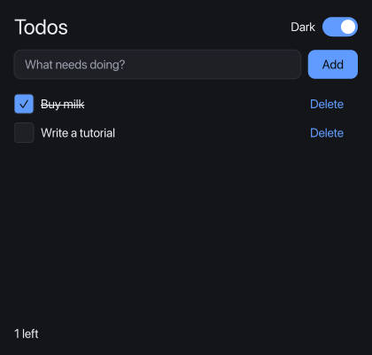

# Getting started

This guide builds a small todo list with Stipple: a text field to add todos,
checkboxes to tick them off, buttons to delete them, and a switch for dark
mode. Then it tests the app without a window. It assumes you know Rust; it
doesn't assume you know Stipple.



The finished app is [`examples/todo`](../examples/todo/src/main.rs) in this
repository (`cargo run -p todo`). The code below is compiled by `cargo test`,
so it stays in step with Stipple.

## 1. A new project

```sh
cargo new todos
cd todos
cargo add stipple
```

Stipple needs Rust 1.88 or newer, and no system libraries: it talks to
Wayland, X11, Win32 and Cocoa itself. This guide follows the repository's
`master` branch; until its next release reaches crates.io, depend on it from
git instead: `cargo add stipple --git https://github.com/KarpelesLab/stipple`.

## 2. A window

Replace `src/main.rs` with:

```rust no_run
use stipple::prelude::*;

fn view(_state: &(), cx: &mut Cx<()>) -> Element {
    label(cx, "Hello, Stipple!")
}

fn main() {
    App::new((), view).title("Todos").run();
}
```

`cargo run` opens a window saying hello.

An `App` owns your state (here `()`, nothing yet) and a view: a function
from the state to a tree of `Element`s. Stipple calls it again after anything
that may change the state, and redraws what changed. Widgets are plain
functions that take `cx` first: it carries the theme they draw with, and
it's where they register what happens on a click or a key.

## 3. State and a view of it

A todo list needs the todos, and the text being typed:

```rust no_run
use stipple::prelude::*;

struct Todo {
    text: String,
    done: bool,
}

#[derive(Default)]
struct Todos {
    draft: TextInput,
    items: Vec<Todo>,
}

impl Todos {
    /// Add the draft as a new todo, and empty the field.
    fn add(&mut self) {
        let text = self.draft.take();
        if !text.trim().is_empty() {
            self.items.push(Todo {
                text: text.trim().to_string(),
                done: false,
            });
        }
    }
}

fn view(state: &Todos, cx: &mut Cx<Todos>) -> Element {
    column(vec![
        heading(cx, "Todos"),
        row(vec![
            text_field(cx, &state.draft, |s| &mut s.draft)
                .placeholder("What needs doing?")
                .on_submit(cx, Todos::add)
                .grow(1.0),
            button(cx, "Add").on_tap(cx, Todos::add),
        ])
        .gap(8.0),
        column(state.items.iter().map(|todo| label(cx, &todo.text)).collect()).gap(4.0),
    ])
    .gap(12.0)
    .padding(Insets::uniform(16.0))
}

fn main() {
    App::new(Todos::default(), view).title("Todos").run();
}
```

Type something and press Enter (or click Add): it joins the list.

- **Layout.** `column` stacks its children top to bottom and `row` left to
  right; both take a `Vec` of them. `.gap(..)` spaces them and `.padding(..)`
  keeps them off the edges. `.grow(1.0)` lets the field take the room the
  button leaves. A row centers its children vertically and a column stretches
  them to its width. [layout.md](layout.md) has the rest.
- **Handlers** run against the state: `on_tap(cx, Todos::add)` calls
  `add(&mut Todos)` on a click, and `on_submit` on Enter in the field. A
  closure works too: `.on_tap(cx, |s| s.items.clear())`. Since `cx` comes
  first, Rust knows `s` is a `&mut Todos`: no annotations.
- **State.** `#[derive(Default)]` starts it empty: no todos, an empty
  field.
- **A text field** edits a `TextInput` in your state, which the field reaches
  through an accessor, `|s| &mut s.draft`. `take()` returns its text and
  empties it. The placeholder shows while it's empty.

## 4. Ticking and deleting

Each todo gets a checkbox and a Delete button. Give the row a function of its
own:

```rust ignore
fn todo_row(cx: &mut Cx<Todos>, i: usize, todo: &Todo) -> Element {
    let mut text = label(cx, &todo.text);
    if todo.done {
        text = text.strikethrough();
    }
    row(vec![
        checkbox(cx, todo.done, move |s| s.items[i].done = !s.items[i].done).a11y_label(&todo.text),
        text,
        spacer(),
        Button::new("Delete")
            .variant(Variant::Ghost)
            .view(cx)
            .on_tap(cx, move |s| {
                s.items.remove(i);
            }),
    ])
    .gap(8.0)
}
```

The handlers capture the todo's index: the view is rebuilt after each
change, so it always matches the list. `button(cx, "Add")` is the common,
filled button; `Button` makes the other variants (a ghost button is just its
text). `spacer()` pushes what follows to the row's end. The checkbox has no
text of its own, so `a11y_label` gives screen readers (and the test in
step 6) a name for it.

In the view, the list becomes a scrolling one, built from these rows:

```rust ignore
        scroll(cx, 200.0).grow(1.0).children(
            state
                .items
                .iter()
                .enumerate()
                .map(|(i, todo)| todo_row(cx, i, todo))
                .collect(),
        ),
```

`scroll(cx, 200.0)` is a column at least 200 pixels tall that scrolls what
doesn't fit; `.grow(1.0)` gives it the rest of the window's height. Under it,
the finished view counts what's left to do:
`label(cx, format!("{left} left"))`, with `left` counted from
`state.items` before the `column`.

This shows the one rule for containers. `row` and `column` take their
children directly. A container that needs `cx` itself (`scroll`, `panel`,
`toolbar`) is built first, and its children are added after it, with
`.children(vec![…])` or `.child(el)`: `panel(cx).children(vec![label(cx,
"Hi"), button(cx, "OK").on_tap(cx, …)])`. That way `scroll(cx, ..)` is done
with `cx` before the rows use it to register their handlers.

## 5. Dark mode

Add a `dark: bool` to the state:

```rust ignore
#[derive(Default)]
struct Todos {
    draft: TextInput,
    items: Vec<Todo>,
    dark: bool,
}
```

a switch to the view, in a row with the heading:

```rust ignore
        row(vec![
            heading(cx, "Todos"),
            spacer(),
            label(cx, "Dark"),
            switch(cx, state.dark, |s| s.dark = !s.dark),
        ])
        .gap(8.0),
```

and pick the theme from the state:

```rust ignore
fn app() -> App<Todos> {
    App::new(Todos::default(), view)
        .title("Todos")
        .logical_size(Size::new(420.0, 400.0))
        .theme_with(|state, _system| {
            if state.dark {
                Theme::dark()
            } else {
                Theme::light()
            }
        })
}
```

`main` is now `app().run();`. `theme_with` runs before each build; when the
theme it returns changes, the window cross-fades to it. Its second argument
is the theme set with `.theme(..)`: return it to follow the system's light
or dark mode (`Theme::native()` tracks it). Every widget reads its colors
from the theme, so nothing else changes.
`Theme::light().accent(color).radius(10.0)` makes a theme of your own.

That's the app: [`examples/todo/src/main.rs`](../examples/todo/src/main.rs)
has it whole.

## 6. Testing it without a window

An `App` runs headless too: `render_once` builds and draws a frame off
screen, and `click_at`, `type_text` and `press_key` deliver input as the
window would. The accessibility tree (what screen readers see) says where
everything is. This is the example's `--selftest`, which CI runs:

```rust ignore
/// Where the `n`th element with `role` (and `name`, unless empty) was laid
/// out in the last frame.
fn find(app: &App<Todos>, role: Role, name: &str, n: usize) -> Result<Point, String> {
    let tree = app.accessibility_tree().ok_or("no frame yet")?;
    tree.descendants()
        .into_iter()
        .filter(|node| node.role == role && (name.is_empty() || node.name == name))
        .nth(n)
        .map(|node| node.bounds.center())
        .ok_or(format!("no {role:?} {name:?} #{n}"))
}

fn selftest(png: &Path) -> Result<(), String> {
    // Changes snap instead of animating, so each frame shows the result.
    stipple::anim::set_reduced_motion(Some(true));
    let mut app = app();
    app.render_once();

    // Click the field, then type three todos, each followed by Enter.
    app.click_at(find(&app, Role::TextField, "", 0)?);
    for text in ["Buy milk", "Water the plants", "Write a tutorial"] {
        app.type_text(text);
        app.press_key(KeyInput::Enter);
    }
    app.render_once();
    let texts: Vec<&str> = app.state().items.iter().map(|t| t.text.as_str()).collect();
    if texts != ["Buy milk", "Water the plants", "Write a tutorial"] {
        return Err(format!("added {texts:?}"));
    }
    if !app.state().draft.is_empty() {
        return Err("Enter left the text in the field".into());
    }

    // Tick the first one, delete the second.
    app.click_at(find(&app, Role::CheckBox, "Buy milk", 0)?);
    app.render_once();
    app.click_at(find(&app, Role::Button, "Delete", 1)?);
    app.render_once();
    let done: Vec<bool> = app.state().items.iter().map(|t| t.done).collect();
    if done != [true, false] {
        return Err(format!("done flags after a tick and a delete: {done:?}"));
    }

    // Dark mode, and a picture of the result.
    app.click_at(find(&app, Role::Switch, "", 0)?);
    if !app.state().dark {
        return Err("the switch didn't turn dark mode on".into());
    }
    let frame = app.render_once();
    frame
        .save_png(png)
        .map_err(|e| format!("{}: {e}", png.display()))?;
    println!("todo: wrote {}", png.display());
    Ok(())
}
```

(`Role` is `stipple::core::Role`, and `Path` is `std::path::Path`.) Call it
from a `#[test]` and `cargo test` checks the app, as the example does; the
PNG shows what it drew. Positions come from the last frame, so render again
after a change before looking something up. `render_once` draws a frame as
the window would at that moment, so a change that animates (the switch's
knob, the theme's cross-fade) shows its first step: reduced motion makes
them snap, as it does for users who ask for it.

## Next steps

- [Layout](layout.md): stacks, wrapping, grids, layers and size limits.
- [Widgets](widgets.md): every widget, and the ones that keep state (select,
  number input, split pane, toolbar, toasts, tabs…); then
  [lists, tables and trees](lists-and-tables.md) for long lists.
- [Timers and background work](async.md): `cx.handle()` returns an
  `AppHandle` that changes the state from timers, other threads or async
  tasks.
- [Animation](animation.md), [menus](menus.md),
  [drag and drop](drag-and-drop.md), [accessibility](accessibility.md) and
  the other topics in the [docs index](README.md).
- Platforms: [Linux](platforms/linux.md), [Windows](platforms/windows.md),
  [macOS](platforms/macos.md), [iOS](platforms/ios.md),
  [Android](platforms/android.md) and [the web](platforms/web.md): how to
  build, package and run on each.
- The [examples](../examples): `cargo run -p widgetsdemo` shows most widgets,
  and the README lists the rest.
