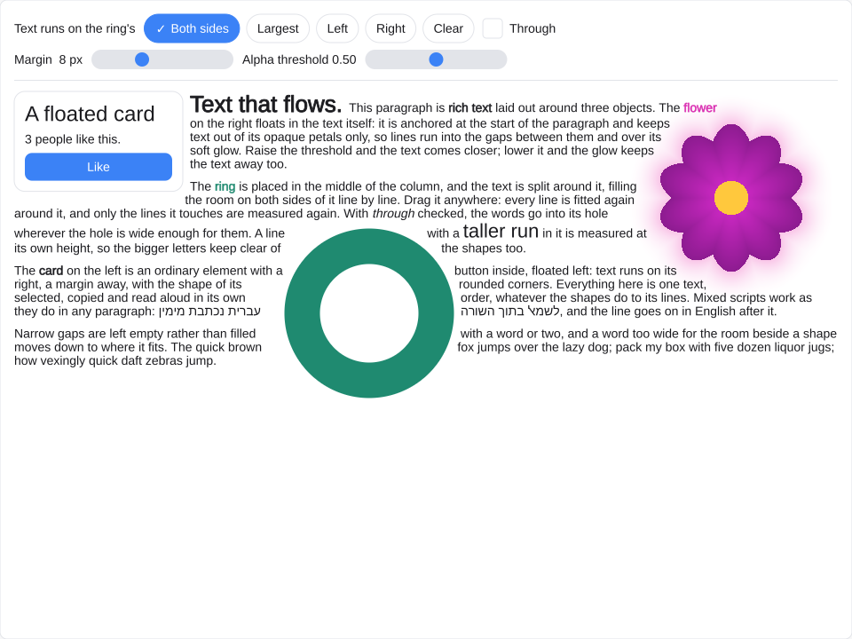

# Text flowing around shapes

Text in Stipple can flow around other things: a card floated to the left of
a paragraph, an image floated right whose transparent pixels the text may
run over, a shape in the middle of a column with text on both sides of it
(and, if you like, inside its holes). It's CSS floats, CSS Shapes and
`wrap-flow`, and Word's "square / tight / through" wrapping, in one engine
that every text in Stipple can go through: plain or rich text, with its
runs, inline images, bidirectional text and line breaking.

<!-- live: textflow -->



```rust
use stipple::prelude::*;

let flower = Arc::new(flower_pixmap());
let text = RichText::new()
    // Floats right, anchored here; text keeps out of its opaque pixels.
    .float(FloatImage::new(flower).right().width(240.0).alpha(0.5).margin(8.0).alt("A flower. "))
    .push("Text that flows around the flower, the card and the ring …");

Element::flow_text(paragraph(cx, text).selectable())
    // An ordinary element, floated left: its box (rounded as its corners).
    .flow_child(FlowItem::float_left().margin(8.0), card)
    // An image placed in the middle; text on both sides, and through its hole.
    .flow_child(
        FlowItem::at(Point::new(300.0, 150.0))
            .shape(FlowShape::alpha(ring.clone(), 0.5))
            .margin(8.0)
            .through(),
        image(ring),
    )
```

## Three ways in

- **`Element::flow_text(text)`** is a container: `text` (a `paragraph`,
  `label` or `Element::rich_text`; it is made to wrap) fills its width, and
  each child added with `.flow_child(item, child)` is placed as its
  `FlowItem` says, the text flowing around it. The children are ordinary
  elements: buttons stay buttons, a dragged child is moved by changing its
  item's position in your state. The container is as tall as the text and
  its children; `.flow_options(FlowOptions)` sets the narrowest room text
  takes and the space between paragraphs.
- **`RichText::float(FloatImage)`** puts a floating image in the text
  itself, so any `paragraph` (or `label` with a width) carries it: no
  container needed. `FloatImage::new(source)` floats right by default;
  `.left()`, `.center()`, `.at(point)`, `.positioned(center)`, `.width`,
  `.height`, `.relative_width(RelativeWidth)`, `.shape`, `.alpha(threshold)`
  (its own pixels as its shape), `.margin`, `.wrap`, `.through`, `.alt`,
  `.frame(color)` (an editor's selection frame with corner handles).
- **`Font::layout_flow` / `RichText::layout_flow`** lay text out yourself
  into a `TextFlow`: a region of a given width (`TextFlow::new(width)`, and
  `.direction` for the paragraphs') holding objects of known sizes
  (`.item(FlowItem, Size)`); `Scene::fill_layout` draws it,
  `TextLayout::flow_item_rect(i)` says where object `i` went,
  `float_rects` where the rich text's floating images went, and
  `line_rect(i)` where each piece of a line is.

## Shapes

A `FlowShape` is the outline of an object within its box, which text keeps
out of, grown by the object's `margin` (CSS's `shape-margin`: a round
margin, so text keeps the same distance all around a curve):

| `FlowShape` | Keeps text out of |
|---|---|
| `Rect` (default) | the box |
| `RoundRect(r)` | the box with rounded corners (a `flow_child` with rounded corners gets this by default) |
| `Ellipse` | the ellipse inscribed in the box (a circle in a square box) |
| `polygon(points)` | a polygon in the box's coordinates (even-odd) |
| `alpha(image, threshold)` | the pixels of `image`, stretched over the box, whose alpha is above `threshold` (0 to 1), like CSS's `shape-image-threshold`; an SVG is rasterized at the box's size |

`FlowShape::blocked(size, top..bottom, margin)` returns what a shape blocks
of a horizontal band, for your own layouts.

## Placement and wrapping

`FlowPlacement` (made by `FlowItem::float_left()`, `float_right()`,
`float_center()`, `at(point)` and `positioned(center)`):

- A **float** goes against the region's left or right edge at the top of the
  line holding its anchor (`FlowItem::anchor(byte)`; for a `FloatImage`,
  where it is in the text), the line then laid out again around it. A float
  that doesn't fit beside the floats already on that band goes below them;
  one after another on the same side sit side by side, `margin` apart.
  Floats are never placed above an earlier float.
- A **centered float** (`FloatCenter`) goes in the middle of the region at
  the top of its anchor's line, below the floats it would overlap; text
  runs on both sides of it by default. A left float beside it stays left of
  it, a right one right of it.
- An object placed **at** a point has its box's top-left there, in the
  text's coordinates.
- A **positioned** object (`Positioned(center)`) has its box's center
  `center.x` times the region's width across and `center.y` times the
  region's width below the top of the paragraph holding its anchor: both in
  fractions of the width, so it keeps its place as the region narrows or
  widens. It is kept within the region's left and right edges and below its
  top. The paragraph's top is where it is without positioned objects: the
  engine lays the text out once without them to find it, then again around
  them, so the object doesn't move when the text it pushes aside does, and
  the text above its paragraph flows around it too (the second pass reuses
  the first one's bands wherever the room is the same).

**Relative widths.** `RelativeWidth::new(fraction)` makes a floating image
(`FloatImage::relative_width`) or an inline one
(`InlineIcon::relative_width`) as wide as `fraction` of the width the text
is laid out in, `.min(px)` and `.max(px)` bounding it (the most winning),
its height keeping the aspect ratio. It's resolved at each layout, so the
image follows the width of the text's box; in an unbounded layout it is as
wide as its `max`, or its natural width.

`WrapSide` says on which sides of an object text runs, as Word's "wrap text"
options and CSS's `wrap-flow` do:

| `WrapSide` | Text runs |
|---|---|
| `Both` | on both sides, where there's room (the default for an object placed at a point) |
| `Largest` | only on the side of the region with more room beside the object's box |
| `Left` / `Right` | only on that side (the default for a right / left float) |
| `Clear` | on neither: only above and below |

By default text keeps out of everything between a shape's leftmost and
rightmost points on a line (CSS's behavior). `FlowItem::through()` (with
`Both`) lets it into the shape's holes and hollows where they're wide
enough, as Word's "through" wrapping does: the ring in `textflow` takes
words in its hole.

## How lines are laid out

For each line the engine takes the band the line would fill, from its top
to its bottom, and asks every object what it blocks of that band (its shape
there, grown by its margin, widened per its `WrapSide`). What's left of the
region's width is the line's room: one or more intervals. Intervals
narrower than `FlowOptions::min_segment` (16 px by default) are left empty.

The paragraph's words then fill the intervals one after another, each
interval taking as many words as fit, and each becoming one display line.
An interval whose first word doesn't fit is skipped. When no word fits
anywhere in the band, the band moves down, to the next object's bottom or a
quarter of a line lower, whichever comes first (shapes narrow and widen
gradually); with no object in the way, an over-long word is placed anyway,
overflowing, as unflowed text does.

All the pieces of one band share a top and a baseline. A band is as tall as
the tallest run that ends up in it: when a bigger run lands on the line, the
band is measured again at its height and the line fitted again, so large
text keeps clear of the shapes too.

Paragraphs (`\n`) start on a new band, `FlowOptions::paragraph_spacing`
apart.

### Bidirectional text

Each paragraph's embedding levels are resolved once, over the whole
paragraph (UAX #9 rules P to I). The paragraph's text then fills a band's
intervals in its own direction: left to right in a left-to-right paragraph,
right to left (the rightmost interval first) in a right-to-left one. Each
interval's piece is a display line of its own: its characters are reordered
on their own (rules L1 and L2), and it sits against its interval's start
edge, the left one or, right to left, the right one. A mixed line's
reordering therefore never crosses a shape.

## Selection, carets and screen readers

A flowed text is still one text element. Its display lines are its pieces,
in text order, so caret positions, hit testing (`TextLayout::index_at`
picks the band by `y`, then the piece under or nearest `x`) and selection
rectangles work as they do in any text; a selection running across a shape
highlights the pieces on both sides. `.selectable()` texts select, copy and
reach screen readers whole, in logical order; a floating image is one
U+FFFC whose `alt` text stands for it when copied or read aloud. Text under
a child drawn over it (a card, an image, a control) isn't selected by a
press there: the child takes the press.

## For an editor

The rich text editor (and anything else that edits `RichText`) can use
floats as it uses inline images:

- A float is one U+FFFC in `RichText::text()`, so byte indices, carets and
  selections count it as one character, which takes no room in its line.
  `RichText::floats()` lists them with their anchors; `insert_float(at,
  image)` adds one into existing text, splitting the run it lands in.
- `RichText::layout` (and so `label`, `paragraph`, `Element::rich_text`)
  goes through the flow engine whenever the text has a float, so the
  editor's own layout, caret and hit testing see the flowed lines with no
  extra work; `RichText::layout_flow` adds objects the editor places itself.
- `TextLayout::object_rects()` says where every image went, inline and
  floating, by the byte of its U+FFFC: what an editor hit-tests to select,
  resize or move one. `Element::on_text_hit` hands a press or drag on an
  editable text to a handler with these boxes, the pointer and the text's
  width (`TextHit`); the rich editor selects, resizes and moves its
  images with it.
- `plain_text()` gives the floats' `alt`; exporting to HTML, a float is an
  `` (CSS can express all of `FloatImage` but `through`).

## Performance

- An alpha shape is turned once into per-row intervals (in logical pixels,
  grown by the margin), cached per image, box size, threshold and margin
  (the 32 most recently used), so moving or reflowing around it doesn't
  scan its pixels again.
- Each band's filled and shaped lines are memoized by the text, its looks,
  where the band starts and the room it had (per text, the 16 most recently
  laid out texts). A layout asked for again (to measure, lay out, paint and
  hit-test the same frame) costs only the bands' room queries; dragging an
  object fills and shapes again only the lines whose room it changed.

## Limits

- Breaks are at spaces, as everywhere in Stipple: no hyphenation, and a word
  is never split across pieces.
- Pieces are start-aligned; there's no justification.
- Floats don't avoid objects placed at a point, and objects never avoid one
  another: only the text flows.
- Left and right are physical: a right-to-left UI doesn't swap them.
- The objects a text flows around belong to that one text; text doesn't
  flow from one container into another.

## Trying it

```sh
cargo run --example textflow
cargo run --example textflow -- --check   # render off screen and check
```

Drag the ring, switch which sides of it text runs on, check "Through", and
move the sliders for the margin and the alpha threshold: the flower's glow
is 60% opaque at its edge and fades out, so a low threshold keeps text out
of the glow too. CI runs `--check` on X11 and drags the ring with
`xdotool`, checking that it moves and the text reflows.
